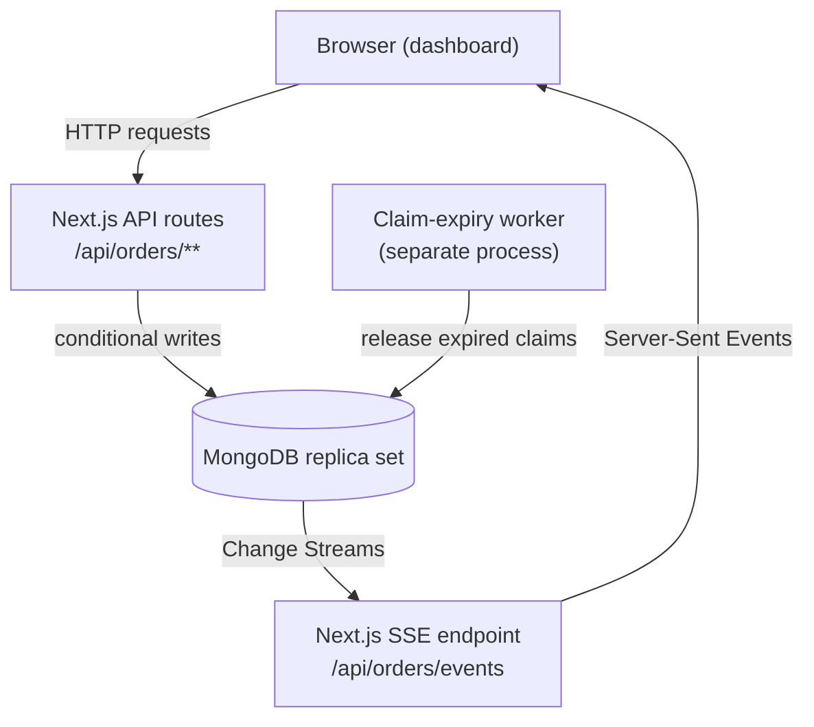
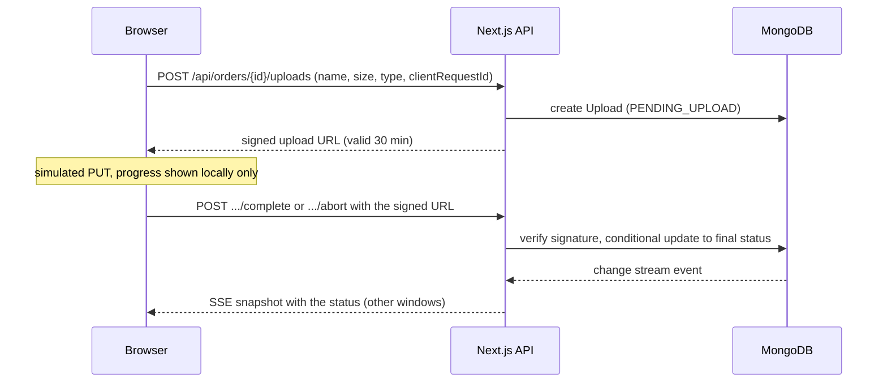

# SignFlow

SignFlow is a dashboard for managing custom signage orders. Orders move through a server-enforced status lifecycle, vendors are assigned, and installers claim ready jobs with exactly one winner per job. A claim must pass a simulated verification within three minutes or it expires. Print files go through a simulated direct-to-cloud upload with signed URLs, and every open window stays in sync through MongoDB Change Streams and Server-Sent Events.

> This is a take-home **demonstration**, not a production system. Identity and payment verification and file storage are **simulated**. Installers and vendors are fixed demo identities without login, so anyone who can open the app can change the demo data.

## Table of Contents

- [Live Demo](#live-demo)
- [Quick Start with Docker](#quick-start-with-docker)
- [Architecture and Tech Stack](#architecture-and-tech-stack)
- [Core Design](#core-design): [schema](#database-schema), [lifecycle](#order-lifecycle), [atomic writes](#conditional-atomic-writes), [claim expiry](#three-minute-claim-expiry), [uploads](#simulated-direct-to-cloud-upload), [live updates](#live-updates-without-polling)
- [Testing](#testing)
- [Demo Limitations](#demo-limitations)
- [Documentation](#documentation)

## Live Demo

**https://sign-flow-flame.vercel.app**

- The deployment is protected by Vercel Authentication. **The reviewer access link is provided separately** and is not stored in this repository.
- Open the link in a private window and use a second window in the same browser to see live updates; pick a different installer in each window (**Acting as installer**). The data is shared by everyone with the link. Access steps, hosting (Vercel Hobby with a Vercel Daemon, MongoDB Atlas) and cloud check results: [docs/deployment.md](docs/deployment.md).

## Quick Start with Docker

### Run with Docker

**Prerequisites:** Docker with Compose v2 (Docker Desktop, or Docker Engine with the Compose plugin); Node.js is not needed. From the repository root, create `.env` with a random upload-signing secret (generated inside a container; this overwrites an existing `.env`), then build and start MongoDB, the schema setup, the app and the expiry worker. `--wait` returns once the app is healthy; the first build takes about 2 to 3 minutes.

```sh
# Linux / macOS
echo "UPLOAD_SIGNING_SECRET=$(docker run --rm node:24.14.0-bookworm-slim node -e "process.stdout.write(require('crypto').randomBytes(32).toString('base64url'))")" > .env
docker compose up -d --build --wait
```

```powershell
# Windows PowerShell
$secret = docker run --rm node:24.14.0-bookworm-slim node -e "process.stdout.write(require('crypto').randomBytes(32).toString('base64url'))"
Set-Content -Path .env -Value "UPLOAD_SIGNING_SECRET=$secret" -Encoding ascii
docker compose up -d --build --wait
```

Open **http://127.0.0.1:3080**. Stop without deleting data with `docker compose stop`, and start again with `docker compose up -d --wait` (`docker compose down -v` would delete all data of the Docker run). If port 3080 is taken, add `APP_PORT=<port>` to `.env`. Troubleshooting, local development and Docker internals: [docs/development-and-testing.md](docs/development-and-testing.md#troubleshooting).

## Architecture and Tech Stack



API routes handle every request (business logic in `src/lib/*/service.ts`), live event processing runs in the Next.js server through one Change Stream per server process, and a separate worker only cleans up expired claims; expiry itself is enforced by the API.

| Area | Technology |
| --- | --- |
| Framework and UI | Next.js 16 (App Router), React 19, TypeScript 5 (strict), Tailwind CSS 4, shadcn/ui |
| Data and live updates | MongoDB 8 (replica set), Prisma 6 (MongoDB connector; Prisma 7 has none), Change Streams via the `mongodb` driver 7, Server-Sent Events |
| Validation and tests | Zod 4, Vitest 5, two-window browser check over the Chrome DevTools Protocol |
| Runtime | Node.js 24, Docker Compose; Vercel and MongoDB Atlas for the live demo |

## Core Design

The task requires documentation of the schema, the locking strategy and the upload pipeline; each is summarized here, with full detail in [docs/architecture.md](docs/architecture.md).

### Database Schema

| Collection | Purpose | Key fields |
| --- | --- | --- |
| `orders` (`Order`) | one signage order | `title`, `description`, `status`, `version`, `vendorId`, claim fields (`claimState`, `claimInstallerId`, `claimTokenHash`, `claimExpiresAt`, `claimedAt`, `claimConfirmedAt`), `uploadRequestIds` |
| `uploads` (`Upload`) | metadata of one upload attempt | `orderId`, `originalName`, `sizeBytes`, `contentType`, `storageKey`, `status`, `clientRequestId`, `authorizationExpiresAt` |
| `demo_limits` (`DemoLimit`) | coordination only: serializes order creation for the 200-order limit | `_id: "orders"`, `seq` |

`version` increases on every status, vendor or claim change. Only the SHA-256 hash of a claim token is stored, and file content is never stored. Key indexes: `{ claimState, claimExpiresAt }` for expiry scans and unique `(orderId, clientRequestId)` for idempotent uploads.

### Order Lifecycle

`DRAFT -> SUBMITTED -> VENDOR_ACCEPTED -> IN_PRODUCTION -> READY_FOR_INSTALL -> COMPLETED`, and `CANCELLED` only from `DRAFT`, `SUBMITTED` or `VENDOR_ACCEPTED` (before `IN_PRODUCTION`). No skipping, going back or same-status transitions; `COMPLETED` and `CANCELLED` are final, and a vendor is required for `VENDOR_ACCEPTED`. One module (`src/lib/orders/status.ts`) drives both the server check (`400 INVALID_TRANSITION`) and the actions offered in the UI.

### Conditional Atomic Writes

The task's "optimistic database locking" option, with no Redis or in-memory locks: every state change is **one conditional MongoDB update** whose filter holds all preconditions, so check and write are atomic. All time conditions use MongoDB's clock (`$$NOW`), so servers with clock skew cannot disagree.

- **Status and vendor changes** filter on `{ _id, status, version: expectedVersion }`; a concurrent change makes the update match nothing, and the API answers `409 VERSION_CONFLICT`.
- **Claims (no double booking)** succeed only if the order is `READY_FOR_INSTALL` and the claim is free or expired. Of several simultaneous claims, exactly one gets `201` with a claim token; the others get `409 CLAIM_UNAVAILABLE`.
- **Simulated verification:** `PASSED` confirms and `FAILED` releases the claim; both require the same installer and token and an unexpired claim.

### Three-Minute Claim Expiry

- A pending claim expires **180 seconds** after it was made (`claimExpiresAt`). **The API enforces it:** an expired claim counts as free inside the conditional write, and a late verification gets `409 CLAIM_EXPIRED`, even when the worker is stopped.
- **The worker cleans up:** `scripts/claim-expiry-worker.mts` scans every 5 seconds through the expiry index and releases each expired claim with a conditional update; the change reaches every window through the Change Stream. Several workers can run safely, and a `CONFIRMED` claim never expires.

### Simulated Direct-to-Cloud Upload



- **Signed authorization:** HMAC-SHA256 with the server-only `UPLOAD_SIGNING_SECRET` over the upload, order, server-generated `storageKey`, exact size, content type and expiry; a modified or foreign URL gets `403 UPLOAD_SIGNATURE_INVALID`.
- **Local progress, stored metadata:** progress stays in the uploading window with no database write per percent; only the upload record and its final status (`COMPLETED`, `CANCELLED`, `FAILED`) are stored and pushed to other windows. Authorization is idempotent per `clientRequestId`, files can be up to 5 GiB, and no bytes are sent (the URL points to `https://simulated-storage.invalid`).

### Live Updates without Polling

- `GET /api/orders/events` streams `snapshot` and `heartbeat` events. One Change Stream per server process watches `orders` and `uploads`; a change triggers one re-read of the public order list, pushed to every client. Nothing reads the database on a timer, and upload progress never touches it.
- Each stream ends after 280 seconds (below Vercel's 300-second limit) with a `reconnect` event; the client reconnects at once and stays **Live**. After a stream failure, missed changes are replayed from the last resume token.

## Testing

```sh
npm run check              # typecheck, lint and production build
npm test                   # unit tests (no database)
npm run test:integration   # after npm run db:up: API, claims, uploads, demo limits, SSE (signflow_test)
npm run test:ui            # two-window browser check (needs MongoDB, Edge or Chrome, and a build)
```

On Windows PowerShell use `npm.cmd`. Unit tests cover the status rules, schemas, URL signing, the storage adapter and client merging; integration tests cover concurrent claims, version conflicts, expiry, uploads, demo limits and SSE against a dedicated test database; the UI check runs the main flows in two browser windows at phone and desktop width.

**Results in brief:** the last full automated run passed (87 unit, 117 integration, 23 UI checks), and the final Docker check of the current `main` passed 34 of 34. The production deployment was checked manually; simultaneous claims and an actual `429` were not tested in the cloud, and the WAF rule is verified as configuration only. Details, including what was not checked: [docs/development-and-testing.md](docs/development-and-testing.md#test-results) and [docs/deployment.md](docs/deployment.md#cloud-check-results).

## Demo Limitations

- **No login or permissions:** installers and vendors are demo identities chosen in the browser. Identity and payment verification (demo buttons) and file storage are simulated.
- **Data limits:** at most **200 orders** and **20 upload attempts per order** (failed and cancelled ones included); beyond them, `409 DEMO_LIMIT_REACHED` is shown in the dialog.
- **Rate limit in the deployment (Vercel WAF):** 30 `POST`/`PATCH` requests per 60 seconds per IP on paths starting with `/api/orders`, answered with `429`. It does not limit `GET` requests or SSE connections.
- **Quotas:** the data limits and the WAF rule do not guarantee that Vercel or Atlas free-plan quotas cannot be exhausted. The worker's Vercel Daemon (beta) quota covers about 17 days of continuous running; expiry is still enforced by the API afterwards.

## Documentation

| Document | Contents |
| --- | --- |
| [docs/architecture.md](docs/architecture.md) | components, full data model, status rules, API and error codes, locking and claims, worker, uploads, live updates, UI, demo limits, task requirement coverage |
| [docs/development-and-testing.md](docs/development-and-testing.md) | local development, Docker details, troubleshooting, environment variables, test database, test commands and results, demo walkthrough, dependencies, project structure |
| [docs/deployment.md](docs/deployment.md) | Vercel and Atlas setup, reviewer access, access protection, WAF, quotas, cloud check results, shutdown procedure |

The original task specification is kept locally only and is excluded from Git, Vercel and Docker.
