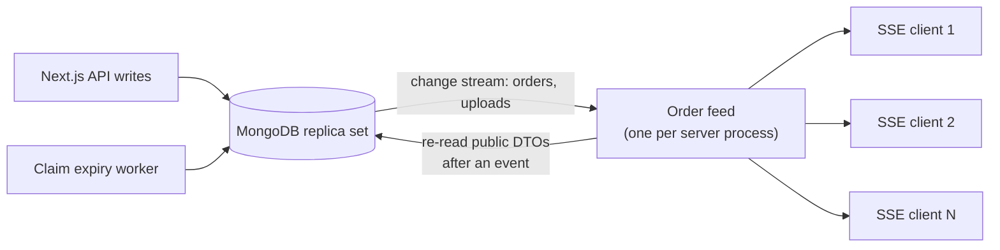

# SignFlow

Dashboard for managing custom signage orders.

> A take-home **demonstration**, not a production-ready system. It covers
> orders with a server-enforced status lifecycle, a minimal vendor
> assignment, temporary installer claims with simulated verification and
> automatic expiry after three minutes, **simulated** direct-to-storage
> uploads with pre-signed URLs, and live updates pushed from MongoDB Change
> Streams over Server-Sent Events. Identities (installers, vendors) are fixed
> demo data with no login, so they are not permissions: anyone who can open
> the site can change the demo data (see
> [Public demo](#public-demo-access-and-data-limits)). Storage and
> payment/identity verification are simulated. It runs fully in Docker Compose (no Node.js needed); it is not
> deployed yet. See
> [Run with Docker](#run-with-docker-reviewer-quick-start),
> [Architecture: API routes and the expiry worker](#architecture-api-routes-and-the-expiry-worker),
> [Specification coverage](#specification-coverage) and
> [Reviewer walkthrough](#reviewer-walkthrough).

## Run with Docker (reviewer quick start)

Needs only **Docker** with Compose v2 (Docker Desktop on Windows/macOS, or
Docker Engine + compose plugin on Linux). No Node.js, no other tools.

```sh
# 1. Create .env with a random signing secret (generated inside a container).
#    Linux/macOS (bash/zsh):
echo "UPLOAD_SIGNING_SECRET=$(docker run --rm node:24.14.0-bookworm-slim node -e "process.stdout.write(require('crypto').randomBytes(32).toString('base64url'))")" > .env
```

```powershell
#    Windows PowerShell:
$secret = docker run --rm node:24.14.0-bookworm-slim node -e "process.stdout.write(require('crypto').randomBytes(32).toString('base64url'))"
Set-Content -Path .env -Value "UPLOAD_SIGNING_SECRET=$secret" -Encoding ascii
```

```sh
# 2. Build and start everything; returns when the app is healthy (first build ~2-3 min).
docker compose up -d --build --wait

# 3. Open the dashboard:
#    http://127.0.0.1:3080
```

Optional: put `APP_PORT=<port>` in `.env` if 3080 is taken. Then follow the
[Reviewer walkthrough](#reviewer-walkthrough) in two browser windows; the
expiry worker is already running.

| Task | Command |
| --- | --- |
| Status | `docker compose ps` |
| Logs (all / one service) | `docker compose logs -f` / `docker compose logs -f app` (or `worker`, `mongodb`, `schema`) |
| Stop, **keeping data** | `docker compose stop` |
| Start again | `docker compose up -d --wait` |
| Restart app and worker | `docker compose restart app worker` |
| Rebuild after code changes | `docker compose up -d --build --wait` |
| Remove containers and network, **keeping data** | `docker compose down` |

> **Warning:** `docker compose down -v` deletes the volumes of this project
> (`signflow_mongodb_data`, `signflow_mongodb_config`) and with them **all
> data** of the Docker run. It does not touch the development database.

What runs (`docker-compose.yml`, Compose project `signflow`):

| Service | Image target | Role |
| --- | --- | --- |
| `mongodb` | `mongo:8.0.38` | single-node replica set `rs0`, member `mongodb:27017`; **no published port** |
| `schema` | `schema` | one-shot `prisma db push` (indexes), then exits 0 |
| `app` | `app` | Next.js standalone server, published on `127.0.0.1:${APP_PORT:-3080}` |
| `worker` | `worker` | claim-expiry worker |

Start-up order uses real readiness, no sleeps: `mongodb` is healthy only when
its replica set is initiated and PRIMARY → `schema` must exit successfully →
`app` and `worker` start; `app` is healthy when `GET /api/orders` answers
(which also proves the database connection). `--wait` returns at that point.

> **Local demo configuration, not a secure public deployment:** MongoDB has
> no authentication (reachable only inside the Compose network), there is no
> TLS, and the app is published on 127.0.0.1 only.

### How the images are built

`Dockerfile` (multi-stage, base `node:24.14.0-bookworm-slim` – the same
Node.js version as development – plus `openssl` for the Prisma engine and
`tini`):

- `deps`: `npm ci` (its `postinstall` runs `prisma generate` for Linux).
- `builder`: `next build` with `BUILD_STANDALONE=1` → `output: "standalone"`.
  The build needs no database and no `UPLOAD_SIGNING_SECRET`.
- `app`: only the standalone server and static assets (~130 MB).
- `worker`: only `scripts/claim-expiry-worker.mts`, the two shared `.mts`
  modules it imports relatively (`src/lib/claims/store.mts`,
  `constants.mts`) and the generated Prisma client (~115 MB); Node runs the
  `.mts` files directly (type stripping).
- `schema`: the full dependency tree (Prisma CLI), used once per start.
- All runtime targets run as the unprivileged `node` user, with `tini` as
  PID 1 forwarding `SIGTERM`. On `docker compose stop` the worker finishes
  its current sweep and exits 0; the app exits on the signal (Next.js
  standalone has no shutdown hook; exit code 143).
- `.dockerignore` keeps `.env*`, `node_modules`, `.next`, test results, git
  data and docs out of the build context; no `.env` is copied into an image.
  `UPLOAD_SIGNING_SECRET` reaches the app only as a run-time environment
  variable from `.env` (Compose refuses to start the app without it).

### Development vs. full Docker run

| | Local development (Windows) | Full Docker run |
| --- | --- | --- |
| Compose file / project | `compose.dev.yaml` / `sign-flow` | `docker-compose.yml` / `signflow` |
| What runs in Docker | MongoDB only | MongoDB, schema, app, worker |
| App and worker | `npm run dev`, `npm run worker:claims` on Windows | containers |
| MongoDB port | `127.0.0.1:27017` | not published |
| Replica set member | `127.0.0.1:27017` | `mongodb:27017` |
| Volumes | `sign-flow_mongodb_data`, `sign-flow_mongodb_config` | `signflow_mongodb_data`, `signflow_mongodb_config` |
| Database URL | `.env` `DATABASE_URL` (127.0.0.1) | set in `docker-compose.yml` (`mongodb`) |

The replica set member address is stored inside each volume when the set is
initiated, and drivers switch to that address after discovery. Windows
processes need `127.0.0.1:27017`; containers need `mongodb:27017`. The two
setups therefore use **separate volumes**. `docker/mongodb/replica-set.js`
never reconfigures an existing set: if a volume was initiated with another
address it stays unhealthy and logs the mismatch. Both setups can run at the
same time (different ports).

## Tech stack

| Tool                     | Version |
| ------------------------ | ------- |
| Next.js (App Router)     | 16.4.6  |
| React / React DOM        | 19.3.1  |
| TypeScript (strict)      | 5.9.3   |
| Tailwind CSS             | 4.3.5   |
| shadcn/ui components     | generated with the shadcn CLI 4.23.0 (not a dependency) |
| ESLint                   | 9.39.x  |
| Prisma / @prisma/client  | 6.19.3  |
| MongoDB Node.js driver (`mongodb`) | 7.8.0 |
| MongoDB (Docker image)   | 8.0.38  |
| Zod                      | 4.6.7   |
| Vitest / Vite            | 5.1.0 / 8.3.8 |

Notes on version choices:

- **Prisma 6.19.3, not 7 or 8** – Prisma ORM 7 has no MongoDB connector;
  the official upgrade guide says to stay on Prisma ORM 6 for MongoDB.
  Prisma 8 supports MongoDB but is still a release candidate (the npm
  `latest` tag currently points to `8.0.0-rc.*`). 6.19.3 is the newest stable
  release with MongoDB support. `prisma` and `@prisma/client` are pinned to
  the same exact version.
- **MongoDB 8.0.38** – latest patch of the 8.0 major release line. Prisma 6
  supports MongoDB 4.2+ (replica set required). The claim logic uses
  `$dateAdd` (MongoDB 5.0+).
- **TypeScript 5.9.3, not 7.x** – `typescript-eslint` (used by
  `eslint-config-next`) supports `typescript >=4.8.4 <6.1.0`. Next.js 16
  and Prisma 6 require TypeScript 5.1+.
- **ESLint 9, not 10** – `eslint-plugin-react`, `eslint-plugin-import` and
  `eslint-plugin-jsx-a11y` (used by `eslint-config-next`) declare peer support
  up to ESLint 9. The official Next.js 16.4.6 template also uses ESLint 9.
- **`mongodb` 7.8.0** – the official Node.js driver, used only for Change
  Streams (Prisma 6 does not expose them). Latest stable release; the 7.x line
  supports MongoDB server 4.4+ and Node.js 20.19+. Next.js treats it as a
  server-external package (not bundled). Prisma keeps doing all reads and
  writes.
- **Zod 4.6.7** – the version already present in the lockfile (transitive
  dependency), now declared directly.
- **Vitest 5.1.0** – needs `vite` as a peer dependency, pinned to 8.3.8.
- Tailwind CSS v4 is wired through `@tailwindcss/turbopack` (as generated by
  `create-next-app`), so there is no `tailwind.config` or PostCSS config.
- **shadcn/ui**: the components in `src/components/ui` are source files; at
  run time they need only `radix-ui`, `cn`, `class-variance-authority`,
  `lucide-react` and `tw-animate-css`. The one file they used from the
  `shadcn` CLI package (its Tailwind variants, MIT) is vendored as
  `src/app/shadcn-tailwind.css`, so the CLI and its large dependency tree are
  not installed. To add components later, run
  `npx.cmd shadcn@4.23.0 add <name>`.
- `next.config.ts`: `cacheComponents` (Next.js 16 default; API routes call
  `connection()`, the page is a static shell) and `partialPrefetching` (Next
  16.4 warns without it next to `cacheComponents`; it only affects `<Link>`,
  which this single page does not use), plus the Tailwind Turbopack loader.
- `tsconfig.json` enables `allowImportingTsExtensions` (allowed because of
  `noEmit`). Modules that the expiry worker loads directly with Node
  (`src/lib/claims/store.mts`, `constants.mts`) are `.mts` files imported
  with their extension; see [Expiry worker](#expiry-worker).

## Prerequisites

- **Node.js `^22.18.0 || ^24.0.0 || >=26.0.0`** (`engines` in `package.json`).
  This is the intersection of the tools' requirements: Vitest 5
  (`^22.12 || ^24 || >=26`), ESLint 9 (`^20.19 || ^22.13 || >=24`), Next.js 16
  (`>=20.9`), and the `.mts` scripts run directly by Node, which need native
  TypeScript type stripping (on by default from 22.18). Developed with
  Node.js 24.14.0.
- npm (developed with npm 11.9.0)
- Docker Desktop with Linux containers (for the local database)
- Git

## Local development (Windows PowerShell)

Next.js and the worker run directly on Windows; only MongoDB runs in Docker
(`compose.dev.yaml`, wrapped by `npm run db:up` / `db:stop`). PowerShell may
block `npm.ps1`/`npx.ps1`; use `npm.cmd` and `npx.cmd` as below.

### First run

```powershell
npm.cmd ci                        # install; postinstall runs `prisma generate`
Copy-Item .env.example .env       # DATABASE_URL and TEST_DATABASE_URL (git-ignored)
# Put a random secret into UPLOAD_SIGNING_SECRET in .env, e.g. generate one with:
node -e "console.log(require('crypto').randomBytes(32).toString('base64url'))"
npm.cmd run db:up                 # start MongoDB, wait until it is PRIMARY
npm.cmd run db:push               # apply the schema (indexes) to the dev database
npm.cmd run dev                   # http://localhost:3000
npm.cmd run worker:claims         # in a second terminal: claim expiry worker
```

Port 27017 on `127.0.0.1` must be free. Check with:

```powershell
Get-NetTCPConnection -LocalPort 27017 -State Listen -ErrorAction SilentlyContinue
```

### Later runs

```powershell
npm.cmd run db:up
npm.cmd run dev
npm.cmd run worker:claims         # second terminal; Ctrl+C stops it gracefully
```

After changing `prisma/schema.prisma`, run `npm.cmd run db:push` (dev) and
`npm.cmd run db:push:test` (test; also run automatically by
`test:integration`).

### Stop the database (keeps data)

```powershell
npm.cmd run db:stop               # docker compose -f compose.dev.yaml stop mongodb
```

`docker compose -f compose.dev.yaml down` (without `-v`) also keeps the data:
it removes the container and network but not the named volumes.

> **Warning:** `docker compose -f compose.dev.yaml down -v` or `docker volume
> rm sign-flow_mongodb_data` **permanently deletes all local development
> data.**

### Checks and tests

```powershell
npm.cmd run typecheck            # Next.js route types + tsc --noEmit
npm.cmd run lint                 # ESLint
npm.cmd run build                # production build (no database needed)
npm.cmd run check                # all three, in order

npm.cmd test                     # unit tests (no database)

# The following need the database: npm.cmd run db:up
npm.cmd run test:integration     # db:push:test, then API/claims/uploads/SSE tests on signflow_test
npm.cmd run test:db              # Prisma connectivity smoke test (signflow_test)
npm.cmd run test:db:persistence  # data survives a restart of the dev mongodb service (signflow_test)
```

### UI check (two browser windows)

`tests/ui/ui-check.mts` drives two headless browser windows (A at 390 px,
B at desktop width) through the Chrome DevTools Protocol. It covers order
creation and a status change, two installers claiming at the same time,
verification, claim expiry with the expiry worker, a simulated upload (the
*Print files* dialog must fit at 390×844 and 768×1024 before, during and
with a history of long file names), an expired claim taken over by another
installer who fails verification, claims again, passes and completes (no
stale "Claimed as …"/"open again" messages and no false expiry notice in
either window), the verification buttons' layout at both widths, live
updates in the other window and the 390 px layout. It starts its own
`next start` (port 3100) and expiry worker against `signflow_test`, and
deletes only the orders/uploads it created.

Prerequisites: Microsoft Edge or Google Chrome installed (or set
`UI_TEST_BROWSER` to a Chromium-based browser executable), MongoDB running,
the test schema applied, and a production build:

```powershell
npm.cmd run db:up
npm.cmd run db:push:test
npm.cmd run build
npm.cmd run test:ui            # ~1 minute; screenshots in test-results/ui/ (git-ignored)
```

`UI_TEST_PORT` changes the app port if 3100 is taken. No extra npm packages
are needed (it uses Node's built-in `WebSocket` and `fetch`).

## Test database

All automated database tests write only to the database in
`TEST_DATABASE_URL` (`signflow_test`), never to `DATABASE_URL` (`signflow`).

- Vitest's integration project sets `DATABASE_URL` to `TEST_DATABASE_URL`
  (`vitest.config.mts`); `tests/integration/setup.ts` runs before every test
  file and throws, before any write, unless the guard passes.
- The guard (`tests/support/test-database.mts`, also used by the `scripts/`
  DB checks and `db:push:test`) refuses to run when `TEST_DATABASE_URL` is
  missing, when its database name does not end in `_test`, or when it names
  the same database as `DATABASE_URL`.
- `npm run test:integration` first applies the schema to the test database
  (`scripts/db-push-test.mts`).
- Tests record the id of every document they create and delete exactly those
  ids in `finally`, even when a test fails. Nothing clears a collection.
- Time-dependent claim tests inject a fixed clock (`now`) into the service or
  set a dedicated past expiry on their own test record. Nothing waits three
  minutes and the production TTL is not changed.

## Orders

### Model

`prisma/schema.prisma`, collection `orders`:

| Field              | Type                    | Notes |
| ------------------ | ----------------------- | ----- |
| `id`               | ObjectId (`_id`)        | |
| `title`            | string                  | required, trimmed, 1–120 characters |
| `description`      | string, optional        | trimmed, up to 2,000 characters; blank → none |
| `status`           | `OrderStatus` enum      | default `DRAFT` |
| `version`          | int                     | default `0`; incremented on every status, vendor **or claim** change |
| `createdAt`        | DateTime                | default now |
| `updatedAt`        | DateTime                | updated on every write |
| `vendorId`         | string, optional        | demo vendor id (`src/lib/vendors/vendors.ts`); missing/null = no vendor |
| `claimState`       | `ClaimState` enum, optional | `NONE` / `PENDING_VERIFICATION` / `CONFIRMED`; missing or null means `NONE` |
| `claimInstallerId` | string, optional        | demo installer id of the current claim |
| `claimTokenHash`   | string, optional        | SHA-256 of the claim token (the token itself is never stored) |
| `claimExpiresAt`   | DateTime, optional      | expiry of a pending claim; **the source of truth for expiry** |
| `claimedAt`        | DateTime, optional      | when the current claim was made |
| `claimConfirmedAt` | DateTime, optional      | when verification passed |
| `uploadRequestIds` | string list             | `clientRequestId`s of the upload attempts that hold a place under the per-order [demo limit](#public-demo-access-and-data-limits); missing = none; never in the API |

Indexes: `{ createdAt: -1, _id: -1 }` (list order) and
`{ claimState: 1, claimExpiresAt: 1 }` (finding expired pending claims).

**Existing documents.** All claim fields are optional on purpose: documents
written before claims existed have none of them, and Prisma cannot read a
document that lacks a required field. Code treats a missing/null
`claimState` as `NONE` (the API maps it, and the conditional writes use
`$ifNull`), so no backfill is required; `db push` only adds the index. When
these fields were added, both databases had no documents. A test inserts a
document without claim fields and claims it.

Assumptions: the specification does not define other order fields
(customer, dimensions, price, …), so none were added. Vendors are a fixed
list of three demo vendors stored by id; there is no vendor collection.

Collection `uploads` (model `Upload`) – metadata of print files; **file
content is never stored in MongoDB**:

| Field                    | Type                 | Notes |
| ------------------------ | -------------------- | ----- |
| `id`                     | ObjectId (`_id`)     | generated by the server before the record is written |
| `orderId`                | ObjectId             | the order (checked to exist; no Prisma relation) |
| `originalName`           | string               | display name only, 1–200 chars, no path separators/control chars |
| `sizeBytes`              | int64                | 1 byte – 5 GiB |
| `contentType`            | string               | allow-listed print format; extension must match |
| `storageKey`             | string, unique       | `orders/<orderId>/<uploadId>/<random>.<ext>` – server-generated, never the file name |
| `status`                 | `UploadStatus` enum  | `PENDING_UPLOAD` → `COMPLETED` \| `CANCELLED` \| `FAILED` |
| `clientRequestId`        | string               | unique per order; makes authorization idempotent |
| `authorizationExpiresAt` | DateTime             | signed URL validity (30 min); a `PENDING_UPLOAD` after it is shown as expired |
| `completedAt`            | DateTime, optional   | |
| `createdAt`, `updatedAt` | DateTime             | |

Indexes: unique `storageKey`, unique `(orderId, clientRequestId)`,
`(orderId, createdAt desc)`.

Collection `demo_limits` (model `DemoLimit`): one document, `{ _id: "orders",
seq }`, written by every order creation to serialize the
[order limit](#public-demo-access-and-data-limits). It holds no order data.

### Status rules

```
DRAFT -> SUBMITTED -> VENDOR_ACCEPTED -> IN_PRODUCTION -> READY_FOR_INSTALL -> COMPLETED
DRAFT | SUBMITTED | VENDOR_ACCEPTED -> CANCELLED
```

- No skipping, no moving backwards, no same-status transitions.
- `CANCELLED` only before `IN_PRODUCTION`.
- `COMPLETED` and `CANCELLED` are final.

The rules live in `src/lib/orders/status.ts`, which has no server
dependencies. The server uses it to enforce transitions; the UI uses it to
show only the allowed actions.

**Vendor rule.** `SUBMITTED -> VENDOR_ACCEPTED` requires an assigned vendor
(`400 VENDOR_REQUIRED`). The vendor can be assigned, changed or removed only
while the order is `DRAFT` or `SUBMITTED` (`400 VENDOR_LOCKED` afterwards),
with the same `expectedVersion` conflict check as status changes. Because
every vendor change bumps `version` and the status write is conditional on
`version`, an order can never reach `VENDOR_ACCEPTED` without a vendor, even
when removal and acceptance race (tested).

**Completion does not depend on the claim or uploads.** The specification
does not require a confirmed installer or an uploaded file before
`READY_FOR_INSTALL -> COMPLETED`. When an order is completed, a still
**pending** claim is released in the same atomic write (it could never be
confirmed any more); a **confirmed** claim is kept as the record of the
assigned installer. Completion and a simultaneous confirmation are both
conditional writes on the same document, so exactly one order of events
happens (tested).

## Public demo: access and data limits

**Demo identities are not permissions.** The installers and vendors are a
fixed demo list chosen in the browser; the server only checks that an id is
on the list. There is no login, so **anyone who can open the site can change
the demo data**:
- read every order, create orders, change any order's status (including
  cancelling or completing it) and assign vendors;
- claim any ready job as any demo installer (verification still needs the
  claim token, which only the claiming tab has);
- start simulated uploads on any order that is not final.

**Data limits** (`src/lib/demo-limits.mts`), because every live update
re-reads and sends the whole order list:

| Limit | Enforcement | Refusal |
| --- | --- | --- |
| **200 orders** in the database | `createOrder` (`src/lib/orders/service.ts`): one MongoDB transaction writes the shared `demo_limits` document, counts the orders and inserts. Concurrent creations write the same document, so MongoDB aborts all but one (write conflict) and they retry with a fresh count. The count is of the real orders, so deleting orders (a manual reset, test cleanup) frees places. | `409 DEMO_LIMIT_REACHED`, shown in the *New order* dialog |
| **20 upload attempts per order**, including failed, cancelled and expired ones | `authorizeUpload` (`src/lib/uploads/service.ts`): one conditional update adds the request's `clientRequestId` to the order's `uploadRequestIds` only if it is already there or fewer than 20 are. Repeating a request (a double click, a retry) uses the same place and returns the same attempt; places are never given back. | `409 DEMO_LIMIT_REACHED`, shown in the *Print files* dialog; the dialog also disables *Start upload* once the order lists 20 attempts |

Both are covered by `tests/integration/demo-limits.test.ts` (parallel
requests for the last places, repeated requests at the limit) and by the UI
check (both messages in the dialogs).

**What the limits do not do.** They bound stored data only. They do not
limit the number of requests, open SSE connections or data transfer, so a
client can still use up the host's and the database's quotas (function time
and memory, bandwidth, the database's operations per second). On free plans
that can mean throttling or a feature being blocked for the rest of the
billing period, not a bill. Rate limiting and monitoring are set up on the
host (see [Public deployment checklist](#public-deployment-checklist-not-deployed-yet)).

## Architecture: API routes and the expiry worker

The specification asks for the backend API and event processing in Next.js
API routes. In this project:

- **API routes** (`src/app/api/orders/**/route.ts`) handle every request:
  orders, status changes, vendor assignment, installer claims and
  verification, and upload authorization, completion and cancellation.
- **Live event processing also runs in the Next.js server**: the SSE route
  (`/api/orders/events`) is fed by one MongoDB change stream per server
  process (`src/lib/realtime/order-feed.ts`). It reacts to writes from any
  process and never polls the database.
- **The expiry worker** (`scripts/claim-expiry-worker.mts`, the `worker`
  service in Docker) is a separate maintenance process. It only resets the
  stored fields of claims whose expiry has passed, so the change reaches every
  client through the change stream.

**Claim expiry is enforced by the API routes, not by the worker.** The
claim and verification writes are conditional on MongoDB's clock: an expired
pending claim already counts as free to claim, and a verification for an
expired claim is rejected (`409 CLAIM_EXPIRED`). If the worker is stopped,
expiry still applies; the stored fields are just cleaned up later. The worker
is a separate process because a request handler has no reliable place for a
timer: a per-claim `setTimeout` is lost on restart and duplicated across
instances, and a TTL index would delete the order. Running the sweep inside
HTTP requests would tie cleanup to traffic. Several workers may run at once,
because each release is a conditional update. This is a deliberate reading of
the specification's wording, not a literal match.

## API

All responses are JSON with `Cache-Control: no-store` (the SSE stream is
`text/event-stream`). Errors have the shape
`{ "error": { "code": "...", "message": "...", "issues": [...]? } }`.

| Method & path                                  | Body                                             | Success |
| ---------------------------------------------- | ------------------------------------------------ | ------- |
| `GET /api/orders`                              | –                                                | `200 { orders, serverTime }` newest first; `serverTime` is the MongoDB clock |
| `POST /api/orders`                             | `{ title, description? }`                        | `201 { order }`, `DRAFT`, version `0` |
| `PATCH /api/orders/[id]/status`                | `{ targetStatus, expectedVersion }`              | `200 { order }` |
| `PATCH /api/orders/[id]/vendor`                | `{ vendorId: "<demo vendor id>" \| null, expectedVersion }` | `200 { order }` |
| `POST /api/orders/[id]/claim`                  | `{ installerId }`                                | `201 { order, claimToken }` |
| `POST /api/orders/[id]/claim/verification`     | `{ installerId, claimToken, outcome: "PASSED" \| "FAILED" }` | `200 { order }` |
| `POST /api/orders/[id]/uploads`                | `{ clientRequestId, originalName, sizeBytes, contentType }` | `201 { upload, uploadUrl, expiresAt }` (`200` when the same `clientRequestId` is repeated) |
| `POST /api/orders/[id]/uploads/[uploadId]/complete` | `{ uploadUrl }`                             | `200 { upload, changed }` (idempotent) |
| `POST /api/orders/[id]/uploads/[uploadId]/abort`    | `{ uploadUrl, reason: "CANCELLED" \| "FAILED" }` | `200 { upload, changed }` (idempotent) |
| `GET /api/orders/events`                       | –                                                | SSE: `snapshot` (`{ orders, serverTime }`), `heartbeat` (`{ serverTime }`) and, before the server ends the stream (after 280 s), `reconnect` events |

`order.vendorId` is a demo vendor id or `null`;
`order.claim` is `{ state, installerId, expiresAt, claimedAt, confirmedAt }`;
`order.uploads` is a list of `{ id, originalName, sizeBytes, contentType,
status, createdAt, updatedAt, expiresAt, completedAt }`. The claim token
appears **only** in the `POST …/claim` response and the signed upload URL
**only** in the `POST …/uploads` response – never in `GET /api/orders`, other
responses or the SSE stream (nor do token hashes, storage keys or client
request ids). There is no endpoint that accepts file content.

| Status | Code                  | When |
| ------ | --------------------- | ---- |
| 400    | `INVALID_JSON`        | body is not valid JSON |
| 400    | `VALIDATION_ERROR`    | invalid id, missing/invalid/unexpected fields, unknown demo installer, malformed token |
| 400    | `INVALID_TRANSITION`  | the status transition breaks the rules |
| 400    | `VENDOR_REQUIRED`     | `VENDOR_ACCEPTED` without an assigned vendor |
| 400    | `VENDOR_LOCKED`       | vendor change after the order left `DRAFT`/`SUBMITTED` |
| 400    | `ORDER_NOT_CLAIMABLE` | claim on an order that is not `READY_FOR_INSTALL` |
| 404    | `NOT_FOUND`           | no order with that id |
| 409    | `VERSION_CONFLICT`    | stale `expectedVersion` on a status or vendor change |
| 409    | `CLAIM_UNAVAILABLE`   | someone holds an active or confirmed claim (also: the loser of a claim race) |
| 409    | `CLAIM_EXPIRED`       | verification for the caller's claim arrived at or after its expiry |
| 409    | `CLAIM_NOT_ACTIVE`    | token/installer does not match the current claim (released, replaced, confirmed) |
| 400    | `ORDER_NOT_UPLOADABLE` | upload authorization for a completed or cancelled order |
| 403    | `UPLOAD_SIGNATURE_INVALID` | upload URL not signed by this server, modified, or for another upload/order (swapped ids) |
| 409    | `IDEMPOTENCY_CONFLICT` | `clientRequestId` reused for a different file |
| 409    | `DEMO_LIMIT_REACHED`  | `POST /api/orders` when 200 orders exist, or `POST …/uploads` when the order already has 20 upload attempts (see [Public demo](#public-demo-access-and-data-limits)) |
| 409    | `UPLOAD_EXPIRED`      | the upload authorization expired before completion/abort |
| 409    | `UPLOAD_CANCELLED` / `UPLOAD_FAILED` / `UPLOAD_ALREADY_COMPLETED` | the attempt already ended differently |
| 500    | `INTERNAL_ERROR`      | unexpected failure (incl. a missing `UPLOAD_SIGNING_SECRET`); details are logged on the server only |

Code layout: route handlers in `src/app/api/orders/**/route.ts` validate
input with Zod and map results to HTTP; business logic is in
`src/lib/orders/service.ts`, `src/lib/claims/service.ts` and
`src/lib/uploads/service.ts`; the conditional claim writes are in
`src/lib/claims/store.mts`.

### Atomic status update

`changeOrderStatus` reads the order (404), checks `expectedVersion` (409)
and the transition (400), then performs **one** conditional MongoDB `update`:
filter `{ _id, status: <status read>, version: expectedVersion }`, update
`$set status`, `$inc version`, `$currentDate updatedAt`. If it matches no
document, another request won → 409.

`prisma.order.updateMany` is not used: with MongoDB, Prisma 6 runs it as an
aggregate that selects matching ids followed by an update filtered by `_id`
alone (seen with the MongoDB profiler), so the condition would not be part
of the write itself. Raw commands go through `prisma.$runCommandRaw`.

## Installer claims (concurrency lock)

This is the specification's "optimistic DB locking" option: no Redis and no
multi-document transactions. Every claim state change is a **single
conditional update** whose filter contains all preconditions, so check and
change are atomic, and every change increments `version`.

| Operation | Filter (all must hold at write time) | Change |
| --------- | ------------------------------------- | ------ |
| Claim | `status = READY_FOR_INSTALL` and (`claimState` is missing/`NONE`, or `PENDING_VERIFICATION` with `claimExpiresAt <= now`) | `PENDING_VERIFICATION`, installer, new token hash, `claimExpiresAt = now + 180 s`, `claimedAt = now` |
| Verification `PASSED` | `claimState = PENDING_VERIFICATION`, same installer, same token hash, `claimExpiresAt > now`, `status = READY_FOR_INSTALL` | `CONFIRMED`, token hash and expiry cleared |
| Verification `FAILED` | same as above without the status condition | released (`NONE`, claim fields cleared) |
| Expiry release | `claimState = PENDING_VERIFICATION`, the token hash seen by the scan, `claimExpiresAt <= now` | released |

Consequences:

- **Only one active claim:** concurrent claims race on the same conditional
  update; exactly one matches and gets `201`, the others get `409
  CLAIM_UNAVAILABLE`.
- **An expired claim is immediately claimable**, even before the worker
  releases it, because the claim filter accepts expired pending claims.
- **Old tokens are useless:** a new claim gets a new random token, and
  verification/release require the current token hash and installer.
- **Confirmed claims never expire:** `CONFIRMED` is excluded from every
  expiry condition and its expiry field is cleared.
- **The clock is MongoDB's.** Writes use `$$NOW` (the database time at write
  time), so app servers and workers with skewed clocks cannot disagree about
  expiry. A claim is active while `now < claimExpiresAt`; at the expiry
  instant it is expired. Tests pass a fixed `now` instead of `$$NOW`.
- The claim token is 32 random bytes (base64url); only its SHA-256 hash is
  stored.

### Demo identities and verification are simulations

- Installers are a fixed list in `src/lib/claims/installers.ts`
  (Alex Rivera, Sam Patel, Jordan Lee). The UI's **Acting as installer**
  selector (per browser tab, `sessionStorage`) chooses one. The server only
  checks that the id is on the list. **This is not authentication or
  authorization**: anyone can send any demo id. The claim token is what ties
  verification to the tab that claimed.
- Identity/payment verification is simulated: the claiming tab shows two
  buttons, clearly marked as a demo, that send `outcome: "PASSED"` or
  `"FAILED"`. No real provider is called.
- The token is kept only in the claiming tab's memory (not in storage or the
  URL). Reloading the tab loses it; the claim then expires after three
  minutes and the job returns to the marketplace.

### Expiry worker

`scripts/claim-expiry-worker.mts` is a separate process (not part of the web
server, no `setTimeout` per claim, no TTL index – orders are never deleted):

```powershell
npm.cmd run worker:claims                 # loop; Ctrl+C stops after the current sweep
npm.cmd run worker:claims -- --once       # one sweep, then exit
$env:CLAIM_SWEEP_INTERVAL_MS = "2000"; npm.cmd run worker:claims   # default 5000 ms
```

Each sweep reads MongoDB's time, finds pending claims with
`claimExpiresAt <= now` through the `(claimState, claimExpiresAt)` index (up
to 100 per batch), and releases each one with the conditional update above.
Because the write re-checks "still pending, same token, expired" at write
time, it never touches a confirmed claim or a newer claim made between the
scan and the write, and several workers can run at once (each claim is
released exactly once). It stops gracefully on SIGINT/SIGTERM/SIGBREAK: the
current sweep finishes, then the database connection is closed. (On Windows,
Ctrl+C delivers SIGINT; `taskkill /F` cannot be handled gracefully.)

The worker is a plain Node process (`node --env-file=.env …`), so it cannot
use the Next.js bundler or the `@/` alias. That is why the code it shares
with the API is in `.mts` files with no app imports. In the full Docker run
it is the `worker` service (same script, started with `node
scripts/claim-expiry-worker.mts`; `docker compose stop` sends SIGTERM).

Expiry does not depend on the worker for correctness: an expired claim is
already claimable and is shown as expired in the UI. The worker only resets
the stored fields.

## Uploads (simulated direct-to-cloud)

> **This is a simulation.** No file bytes are transferred anywhere. The
> "object store" is simulated in the browser, the signed URL points to
> `https://simulated-storage.invalid` (a reserved domain that never
> resolves), and only metadata is saved. The UI says so in every upload
> dialog and marks the 1.5 GB demo file as "Demo · no content".

The specification asks to *simulate* direct-to-cloud uploads of "1GB+" print
files with pre-signed URLs, so no real storage is integrated.

```mermaid
sequenceDiagram
    autonumber
    participant B as Browser (tab A)
    participant API as Next.js API
    participant DB as MongoDB
    participant S as Simulated store (in browser)
    participant O as Other tabs
    B->>API: POST /api/orders/{id}/uploads {clientRequestId, name, size, type}
    API->>DB: order exists and not final? create Upload (PENDING_UPLOAD)
    API-->>B: {upload, uploadUrl (signed), expiresAt}
    B->>S: "PUT" uploadUrl – progress shown locally only
    Note over B,S: no bytes leave the browser; no DB writes per percent
    alt finished
        B->>API: POST …/uploads/{uploadId}/complete {uploadUrl}
        API->>DB: verify signature, then conditional update → COMPLETED
    else cancelled / simulated failure
        B->>API: POST …/uploads/{uploadId}/abort {uploadUrl, reason}
        API->>DB: verify signature, then conditional update → CANCELLED / FAILED
    end
    DB-->>API: change stream event (uploads)
    API-->>O: SSE snapshot with the upload's status (metadata only)
```

**Signed URL.** HMAC-SHA256 with `UPLOAD_SIGNING_SECRET` (server-side only)
over: version, operation (`PUT`), upload id, order id, storage key, exact
size, content type and expiry. Changing any of them, using another upload's
URL (swapped ids) or another order's path gives `403
UPLOAD_SIGNATURE_INVALID`; the signature is compared in constant time.
Completion and abort require the signed URL of exactly that upload, so only
the browser that received it can finish or cancel that attempt.

**Rules.**

- **Final orders:** a NEW upload attempt is refused when the order is
  `COMPLETED`/`CANCELLED` at the time of the request. Uploads live in their
  own collection (no multi-document transaction), so an attempt authorized
  *before* the order became final may still complete or be aborted
  afterwards. This is the defined behavior, not a guarantee that a final
  order never gets a file (tested).
- The order must exist and not be `COMPLETED`/`CANCELLED`. Limits: 1 byte –
  5 GiB (the single pre-signed `PUT` limit of common object stores; larger
  files would need multipart uploads), names up to 200 characters without
  path separators or control characters, allow-listed print formats (PDF,
  TIFF, PNG, JPEG, SVG, EPS/AI, PSD) whose extension must match the type.
- The storage key is generated by the server; the file name is display
  metadata only.
- Authorization is idempotent per `clientRequestId` (one id per "Start
  upload" action): a double click returns the same attempt. "Try again"
  creates a new attempt with a new id; the failed one stays `FAILED`.
- Completion and abort are single conditional writes (`PENDING_UPLOAD` and
  not expired at write time, on MongoDB's clock). Repeating the same
  outcome is idempotent (`changed: false`); completing a cancelled/failed
  attempt, cancelling a completed one, or anything after expiry is refused.
  A request for an old attempt cannot affect a newer one (different id and
  signature).
- Upload progress is local to the uploading tab (the spec's "optimistic UI"
  option). Other tabs see only persisted metadata and status, pushed via SSE.
  Nothing is written to the database per percent.
- Uploads are not tied to the order status flow (not required by the spec),
  and there is no download button, because no file exists.

**Limits of the simulation and how real storage replaces it.**

- *A completion report from the browser is not proof that the file exists.*
  Here the server accepts it after checking the signature and state. With a
  real object store (S3, GCS, Azure Blob), the server would instead check
  the object itself before marking it `COMPLETED` – e.g. `HeadObject` on
  `storageKey` to confirm it exists with the exact signed size/type (and
  optionally a checksum) – or mark it complete from a verified storage event
  (e.g. an S3 `ObjectCreated` notification). The signed URL itself would be
  created by the provider SDK (e.g. `getSignedUrl(PutObjectCommand)`), with
  the content length and type part of the signature, and the store, not this
  server, would enforce the signature on the `PUT`.
- The browser side is `DirectUploadAdapter` in
  `src/lib/uploads/simulated-storage.ts`; a real adapter would `PUT` the
  `File` to `uploadUrl` with `XMLHttpRequest` (for progress events). The
  simulated adapter never reads file content: for a chosen file only its
  name, size and type are used, and the demo file has no content at all.
- Abandoned `PENDING_UPLOAD` attempts are not swept; after
  `authorizationExpiresAt` they are shown as expired and can no longer be
  completed. A real store would also need a lifecycle rule for incomplete
  objects.

## Live updates (Change Streams + SSE)

`GET /api/orders/events` streams `snapshot` events (`{ orders, serverTime }`)
and `heartbeat` events (`{ serverTime }`). Snapshots are pushed by MongoDB
Change Streams; nothing polls the database.



`src/lib/realtime/order-feed.ts`:

- **One change stream per server process**, shared by all SSE clients,
  opened when the first client connects and closed (together with its
  `MongoClient`) when the last one leaves. It watches the `orders` and
  `uploads` collections of the database, so writes from any process – this
  app, the claim-expiry worker, other instances – arrive as events.
- An event only means "something changed": the feed then re-reads the
  snapshot through Prisma (public DTOs only; raw documents, token hashes,
  storage keys and signed URLs are never sent) and pushes it to all clients
  if it differs from the last one. Events that arrive while a read is running
  are coalesced into one more read. Reads happen only after events or
  (re)connects – never on a timer (an integration test asserts this).
- **Start-up race:** the stream is opened and its cursor established
  (`tryNext()`) *before* the first snapshot is read, so no write can fall
  between the snapshot and the stream. A client that connects later gets the
  cached snapshot immediately, then every change.
- **Failures:** the driver resumes transient errors itself. If the stream
  still fails, the feed reopens it with exponential backoff
  (`REALTIME_RETRY_BASE_MS`, default 1 s, max 30 s), **resuming after the
  last resume token**, which replays the changes it missed. If the server
  rejects the token (for example it is no longer in the oplog), the feed
  reopens without it and performs a **full re-sync**.
- **Heartbeats** every `SSE_HEARTBEAT_MS` (default 15 s) keep proxies from
  closing idle connections and refresh the client's clock offset. They never
  query the database: `serverTime` is estimated from the last snapshot's
  MongoDB time plus this process's monotonic clock.
- **Clients:** a new or reconnecting client always starts with the current
  snapshot, so it never keeps stale data. `EventSource` retries by itself
  (`retry: 3000`); if it gives up, the client reconnects with backoff. The UI
  shows **Live** / **Reconnecting…**.
- **Stream lifetime:** the route exports `maxDuration = 300` (the Vercel Hobby
  maximum; it applies to streamed responses too). Each stream ends itself 20 s
  earlier: the server sends a `reconnect` event and runs its normal cleanup,
  and the client reconnects at once without showing *Reconnecting…*. This
  also applies in the Docker run (one short reconnect every 280 s).
- **Merging on the client** (`src/lib/orders/merge.ts`): SSE snapshots, GET
  responses and mutation responses can arrive out of order. Per order the
  higher `version` wins; uploads are merged separately (union by id, and an
  upload never moves back from a final status to pending), because upload
  changes do not bump `order.version`. So an upload change is applied even
  when the version is unchanged, and a late, older response cannot undo it.
- **Feed restarts:** when the last client leaves the feed stops; a client that
  connects right after (e.g. a page reload) gets a fresh initial snapshot even
  if a read from the stopped feed was still running (regression-tested).
- **Cleanup:** on disconnect the subscription and heartbeat interval are
  removed; with no clients left there is no change stream, client, retry
  timer or interval (tests check the feed state and the process's active
  timers).

Limitations: each server process opens its own change stream; each event
re-reads the whole (unpaginated) order list, which is fine for this dataset
size. Change streams require a replica set (already used). The snapshot cache
is per process and is dropped when the last client leaves.

## UI

`src/app/page.tsx` renders a static shell; `src/components/orders/` loads the
list in the browser (initial `GET`, then SSE), so the page build never needs
the database.

- Order list with status, creation date and, for orders ready for install
  (or with a confirmed installer), a claim line: *Open for installers*,
  *Claimed by … · awaiting verification · m:ss left*, *…'s claim expired ·
  open for installers*, or *Installer: … · verified*.
- **Installer assignment** dialog (per order ready for install): claim as the
  acting installer, see who holds the claim and the countdown, and, in the
  claiming tab only, the **Verification simulation (demo)** buttons.
- The countdown uses the server's expiry and the measured offset between the
  local clock and the database clock (`serverTime`). A pending claim is shown
  as expired from its expiry instant, even before the worker runs, and the
  claiming tab gets an expiry message.
- Clear messages for a lost claim race (409), expiry, failed verification
  and status conflicts. Buttons are disabled while a request is in flight.
- **Print files** dialog (per order): choose a file (only name, size and type
  are used) or the 1.5 GB demo file, optionally simulate a network failure,
  start, watch local progress, cancel, try again. Lists every attempt of the
  order with its persisted status. The row shows local progress in the
  uploading tab and the persisted state ("… uploaded", "1 upload in
  progress") in every tab.
- **Vendor** dialog (per `DRAFT`/`SUBMITTED` order): pick one of the demo
  vendors or none; every row shows the vendor. *Mark vendor accepted* stays
  disabled, with a hint, until a vendor is assigned.
- **New order** and **Change status** dialogs.

### Responsive checks (automated vs. manual)

| Width | Automated (`npm run test:ui`) | Manual (browser responsive mode) |
| --- | --- | --- |
| 390×844 (phone) | Whole two-window flow in window A, no horizontal page overflow; Installer assignment buttons; *Print files* dialog before, during and with a history of long file names | *Print files* dialog on the Docker build: found the overflow, which was then fixed and added to the automated check; after the fix, *Print files* was re-checked manually at this size |
| 768×1024 (tablet) | *Print files* dialog only, in the same three states | Dashboard, *New order*, *Vendor*, *Change status*, *Installer assignment* (with the verification buttons) and *Print files* dialogs, all checked before the last *Print files* width fix |
| 1280×900 (desktop) | Whole two-window flow in window B; Installer assignment buttons | – |

Manual two-window claim flows (expiry, another installer taking over,
failed and passed verification, completion) were also run; they found the
stale claim messages and the false expiry notice that the automated check
now covers. Their window sizes were not recorded.

Gaps: at 768 px the automated check measures only the *Print files* dialog;
the dashboard and the other dialogs at tablet width were checked manually,
before the last *Print files* width fix, and have not been re-checked
manually at 768 px since. The fix itself is covered at 768 px by the
automated *Print files* check.

## Specification coverage

E = explicit requirement, G = general wording, A = assumption made here.

| Requirement (spec) | Kind | Where | Verified by | Remaining gap |
| --- | --- | --- | --- | --- |
| Next.js App Router, MongoDB + Prisma, Tailwind + shadcn, TypeScript | E | whole repo | `npm run check` | – |
| Backend API and event processing in API routes | E | `src/app/api/orders/**`, change stream → SSE in the Next.js server | integration, UI check | claim-expiry cleanup runs in a separate worker; expiry is enforced by the API (see [Architecture](#architecture-api-routes-and-the-expiry-worker)) |
| State machine `DRAFT → … → COMPLETED`, enforced in UI **and** backend | E | `src/lib/orders/status.ts`, status route, Change status dialog | unit (all 49 pairs), integration, UI check | – |
| `CANCELLED` only before `IN_PRODUCTION`; invalid jumps blocked with UI feedback and HTTP 400 | E | same | unit + integration (400 `INVALID_TRANSITION`) | UI offers only allowed actions, so the 400 is mostly API-level |
| "manage … vendor assignments" | G | `src/lib/vendors`, vendor route, Vendor dialog | integration (`vendors.test.ts`), UI screenshots | minimal: fixed demo vendors, no vendor accounts |
| Concurrency: multiple installers accept → exactly one assigned (Redis or optimistic DB lock) | E | `src/lib/claims/store.mts` (conditional update) | integration (2 and 12 parallel claims), UI check (two windows) | – |
| Release the lock if identity/payment verification fails within 3 minutes | E | claim expiry (`claimExpiresAt`), FAILED verification, expiry worker | integration (injected clock, worker process), UI check | verification is simulated (demo buttons) |
| Simulate direct-to-cloud upload of 1GB+ files with pre-signed URLs | E | `src/lib/uploads/*`, upload routes, Print files dialog | unit (signing, 5 GiB simulation), integration, UI check | simulated store; completion is client-reported (see Uploads) |
| Real-time upload progress via WS / SSE / optimistic UI, no repeated DB polling | E | local progress (optimistic UI) + Change Streams → SSE | integration (no reads while idle; two clients), UI check | other tabs see status, not per-percent progress (A) |
| Real-time order lifecycle tracking; indicators for state changes, uploads, claims | E/G | SSE feed, Live indicator, row claim/upload lines | integration SSE tests, UI check | – |
| Interactive modals: Order Creation, Status Transitions, Installer Assignment | E | the three dialogs | UI check | – |
| Responsive (mobile, tablet, desktop) | E | Tailwind layout | automated UI check: whole flow at 390 px and 1280 px, *Print files* dialog also at 768 px; manual: dashboard and all dialogs at 768 px, *Print files* at 390 px (see [Responsive checks](#responsive-checks-automated-vs-manual)) | at 768 px the dashboard and the other dialogs are checked manually only, before the last *Print files* width fix |
| Repository with docker-compose (`docker-compose.yml` preferred) | E | `docker-compose.yml`, `Dockerfile` (MongoDB, schema, app, worker) | isolated Compose acceptance run (see Run with Docker) | GitHub repository not created yet |
| README: DB schema, lock strategy, upload pipeline | E | this file | – | – |
| Live deployment URL | E | – | – | **not deployed yet** (see Deployment target requirements) |

Decisions on points the spec leaves open: completion is not tied to a
confirmed claim or an upload; an installer may hold several jobs; a vendor is
required for `VENDOR_ACCEPTED` and locked afterwards.

## Reviewer walkthrough

A short demo of the main flows (dev server, two browser windows). Before
starting: `npm.cmd run db:up`, then `npm.cmd run dev` and, in a second
terminal, `npm.cmd run worker:claims`. Open http://localhost:3000 in **two
windows** side by side.

1. **Order + status:** in window 1 click *New order*, create one; it appears
   in window 2 immediately. *Vendor* → pick a vendor → *Save vendor*. *Change
   status* → *Submit order* → *Mark vendor accepted* → *Start production* →
   *Mark ready for install*. (Try *Mark vendor accepted* without a vendor: it
   is disabled; the API answers `400 VENDOR_REQUIRED`.)
2. **Conflict (two installers):** set *Acting as installer* to different
   people in the two windows. Open *Installer assignment* on the order in
   both windows, then click *Claim as …* in both quickly. One window shows
   "Claimed as …" with a countdown, the other "Another installer claimed this
   job first." A stale status change (e.g. a second window acting on an old
   version) shows the "changed by someone else" message and refreshes.
3. **Verification:** in the claiming window use *Simulate: verification
   passed* (or *failed*, which releases the job at once). The other window
   shows "Installer: … · verified".
4. **Expiry:** claim another ready order and do nothing. The countdown runs
   from 3:00; at 0:00 both windows show the job as open again and the
   claiming window shows "Your previous claim on … expired before
   verification" (also when the worker released the claim first). The
   worker then resets the stored claim. Now claim it in the other window and
   verify: the first window drops its "Claimed as …" message and shows the
   new assignment. Local outcome messages in the assignment dialog are tied to
   the claim they describe and disappear once the latest order data shows a
   different claim; the expiry notice is past tense, so it stays true after
   someone else takes the job. (To skip the wait in a local demo, the UI
   check sets `claimExpiresAt` in the past on its own test record.)
5. **Upload:** *Print files* → *Use a 1.5 GB demo print file* → *Start
   upload* (≈16 s, simulated). The other window shows the file as uploaded.
   Tick *Simulate a network failure* or press *Cancel upload* to see the
   failed/cancelled states and *Try again*.

The same flows run automatically with `npm.cmd run test:ui` (see above).

## Database

Both Compose setups are **local only** (no authentication, a single replica
set member). `compose.dev.yaml` serves Windows development (port published on
`127.0.0.1`); `docker-compose.yml` is the full Docker run (no published
MongoDB port). See [Development vs. full Docker run](#development-vs-full-docker-run).

### Why a replica set

A replica set is a group of `mongod` processes that hold the same data, with
one PRIMARY that accepts writes. MongoDB only supports multi-document
transactions on replica sets, and Prisma's MongoDB connector uses
transactions internally for nested writes. On a standalone server Prisma
fails with `Transactions are not supported by this deployment`. For local
development we run a **single-node** replica set named `rs0`: one member that
is always PRIMARY.

### How it is set up

- `mongod --replSet rs0` runs in the `mongodb` service of either file. Data
  lives in that project's named volumes (`/data/db` and `/data/configdb`).
- `docker/mongodb/replica-set.js` is the container healthcheck. It calls
  `rs.initiate()` only if the set is not initialized yet (safe to re-run),
  reports healthy only when the node is PRIMARY, and refuses (stays
  unhealthy, exit 2) if the volume's set uses a different member address
  than `MONGO_REPLICA_HOST` – it never reconfigures silently. `npm run db:up`
  and `docker compose up --wait` return once it is healthy. To re-run it
  manually (development):

  ```powershell
  docker compose -f compose.dev.yaml exec mongodb mongosh --quiet --file /docker/replica-set.js
  ```

- With `?replicaSet=rs0` the driver first contacts the seed host, discovers
  the members from the replica set config, and then connects to the
  advertised member address. In development that is `127.0.0.1:27017` (host
  and container port identical, published on `127.0.0.1`); in the full run it
  is `mongodb:27017` (set via `MONGO_REPLICA_HOST` in `docker-compose.yml`).
  (If you change the development port, change it in `compose.dev.yaml`,
  `MONGO_REPLICA_HOST`/the script default and both URLs, and use a new
  volume.)

### Environment variables

`.env` (git-ignored; template in `.env.example`). In the full Docker run,
Compose reads only `UPLOAD_SIGNING_SECRET`, `APP_PORT` and
`CLAIM_SWEEP_INTERVAL_MS` from it; the containers' `DATABASE_URL` is fixed in
`docker-compose.yml`.

| Variable                  | Used by | Default / example |
| ------------------------- | ------- | ----------------- |
| `UPLOAD_SIGNING_SECRET`   | upload URL signing (**required**; server-side only, ≥ 32 chars; Docker: injected at run time) | random, e.g. 32 random bytes base64url |
| `APP_PORT`                | Docker run: host port of the app on 127.0.0.1 (optional) | `3080` |
| `DATABASE_URL`            | Next.js (Prisma and the change-stream client), Prisma CLI, expiry worker | dev: `mongodb://127.0.0.1:27017/signflow?replicaSet=rs0`; Docker: `mongodb://mongodb:27017/signflow?replicaSet=rs0` (set in compose) |
| `TEST_DATABASE_URL`       | dev only: integration tests, DB checks, `db:push:test` | `mongodb://127.0.0.1:27017/signflow_test?replicaSet=rs0` |
| `CLAIM_SWEEP_INTERVAL_MS` | expiry worker (optional) | `5000` |
| `REALTIME_RETRY_BASE_MS`  | change-stream reconnect backoff base (optional) | `1000` (max 30 s) |
| `SSE_HEARTBEAT_MS`        | SSE heartbeat interval (optional) | `15000` |
| `MONGO_REPLICA_HOST`      | replica set member address used by `replica-set.js` | dev default `127.0.0.1:27017`; Docker `mongodb:27017` |
| `BUILD_STANDALONE`        | build-time only (set in the `Dockerfile`): `output: "standalone"` | unset locally |

`UPLOAD_SIGNING_SECRET` must never be exposed to the browser (it has no
`NEXT_PUBLIC_` prefix and is only read in `src/lib/uploads/signing.ts`,
which is `server-only`). Rotating it invalidates outstanding upload URLs.

`.env.atlas.local` (git-ignored, also excluded by `.vercelignore` and
`.dockerignore`) holds the Atlas `DATABASE_URL` for one-off commands such as
the initial `prisma db push`. Nothing loads it automatically; pass it
explicitly, e.g. `node --env-file=.env.atlas.local …`. Production variables
are listed in the [deployment checklist](#public-deployment-checklist-not-deployed-yet).

Next.js and the Prisma CLI load `.env` automatically; Vitest loads it through
`loadEnv` in `vitest.config.mts`, and the `.mts` scripts through
`node --env-file=.env`. Do not put `DATABASE_URL` only in `.env.local`: the
Prisma CLI does not read that file. There is no `prisma.config.ts`, because
with one Prisma 6 stops loading `.env` automatically.

### Prisma

- Schema: `prisma/schema.prisma` (MongoDB provider).
- Schema changes are applied with `prisma db push` (`db:push`,
  `db:push:test`). `prisma migrate` is not supported for MongoDB. `db push`
  creates indexes but does not rewrite existing documents.
- Server code imports the shared client from `@/lib/prisma`. It is marked
  `server-only` and reuses one `PrismaClient` across hot reloads in
  development.

## Dependencies and `npm audit`

Last checked with `npm audit` (10 findings: 3 high, 7 moderate; the
`shadcn` CLI and its 5 findings were removed). None is in code that the
running web app or worker loads:

| Finding | Pulled in by | Kind | Status |
| --- | --- | --- | --- |
| `deepmerge-ts` < 8 (high, GHSA-ggr8-5vv4-36mx) via `@prisma/config` and `prisma` | `prisma` 6.19.3 CLI (`generate`, `db push`) | CLI. Listed under `--omit=dev` too, because `@prisma/client` declares `prisma` as an optional peer, but the client runtime does not load `@prisma/config` | only fix is Prisma 7, which has no MongoDB connector → accepted; the CLI only merges this project's own config |
| `minimatch` 10.x (moderate, GHSA-g3hv-75wg-m249) via `typescript-eslint` packages | `eslint-config-next` | dev (lint) | the fixed `minimatch` 11 is outside `typescript-eslint`'s `^10` range; `npm audit fix --dry-run` changes nothing; no override without proof of compatibility |

Runtime dependencies (`next`, `react`, `@prisma/client`, `mongodb`, `zod`,
`radix-ui`, `lucide-react`, `cn`, `class-variance-authority`,
`tw-animate-css`, `server-only`) have no reported findings.

In the Docker images: the `app` and `worker` images contain neither the
Prisma CLI nor the lint toolchain, so none of the findings above is present
there. The one-shot `schema` image contains the full dependency tree (it
needs the Prisma CLI). `npm ci` in the image build prints a deprecation
notice for ESLint 9 (see Tech stack); it is a dev tool and not in the runtime
images.

## Deployment target requirements (not deployed yet)

The app is not a static or purely serverless site. A host needs:

- **A Node.js server that can keep SSE responses open**: a long-running
  server (e.g. the `app` image or `node server.js` from the standalone
  build), or functions that may stream for minutes (Vercel Hobby: up to
  300 s; the client then reconnects after ~3 s and gets a full snapshot).
  One change stream is shared per process or function instance.
- **SSE support end to end**: no response buffering
  (`X-Accel-Buffering: no` is sent), idle timeouts longer than the 15 s
  heartbeat, HTTP/1.1 or HTTP/2 streaming.
- **A continuously running worker** (the `worker` image or `node
  scripts/claim-expiry-worker.mts`) with access to the same database. Several
  instances are safe.
- **MongoDB as a replica set with Change Streams** (e.g. MongoDB Atlas, or a
  self-managed replica set), reachable from app and worker by the member
  addresses it advertises, with authentication and TLS.
- **Secrets as run-time environment variables**: `DATABASE_URL` and
  `UPLOAD_SIGNING_SECRET`.
- Run `prisma db push` (the `schema` target) against the database before the
  first start and after schema changes.
- A real object store and real identity/payment verification would replace
  the simulations before any real use.

## Public deployment checklist (not deployed yet)

Planned target: Vercel Hobby (app; worker as a Vercel Daemon, beta) and a
MongoDB Atlas Free cluster. The Atlas part is set up (see below); nothing on
Vercel has been created and nothing is deployed yet. Plan details
were checked against the Vercel and Atlas documentation in November 2026;
check the linked pages again before relying on them.

**MongoDB Atlas**
- A dedicated database user for this app only: built-in role `readWrite` on
  the database **`signflow`** only, restricted to this cluster, with a long
  random password generated locally. Not `readWriteAnyDatabase` (the user the
  Vercel–Atlas integration creates has that role, so do not use it).
- Network access: `0.0.0.0/0` is required, because Vercel functions have no
  fixed IP addresses. The user's password and TLS are then the only barrier,
  which is why the user is limited to `signflow`.
- MFA on the Atlas account. Never point `TEST_DATABASE_URL` at Atlas.
- Create the indexes once with `prisma db push`, with `DATABASE_URL` set only
  for that command (from `.env.atlas.local`, never written to `.env`).
  *Done:* the cluster, the user `signflow_app` (`readWrite@signflow`) and the
  schema exist; a one-off check created, updated and deleted an order through
  the real services and received a change-stream event.
- Free tier limits: 512 MB, 500 connections, 100 operations/s and 10 GB in /
  10 GB out per 7 days (beyond that Atlas throttles); paused after 30 days
  without connections.

**`vercel.json`**
- `regions: ["iad1"]`: the app's functions run in Washington, D.C. (Hobby
  allows one region); choose the Atlas region close to it.
- `daemons.worker`: the claim-expiry worker, built from `Dockerfile#worker`
  (the `worker` stage, which is also the last one) with the repository root
  as build context, **1 instance in `iad1`, 1 GiB**. The image's own
  `ENTRYPOINT`/`CMD` start it (`tini` → `node
  scripts/claim-expiry-worker.mts`); on a redeploy Vercel sends `SIGTERM`
  and waits 30 s, and the worker stops after its current sweep. The `#stage`
  syntax comes from the `vercel.json` schema; the daemon docs only show a
  plain `Dockerfile`. Daemons are in beta, run only in production, and the
  project's root directory must be the repository root.
- Vercel passes the deployment's environment variables to the image build as
  build arguments. The `Dockerfile` declares none of them, so they never end
  up in the image (checked with dummy values: not in the image config, history
  or files).
- The Next.js app is built by Vercel's Next.js builder as usual; the
  `Dockerfile` is used only for the daemon. The build needs no database and
  no secrets (checked with an unreachable `DATABASE_URL` and an empty
  `UPLOAD_SIGNING_SECRET`).

**Production environment variables** (Vercel → Settings → Environment
Variables, environment **Production** only, type *Secret*: write-only after
saving and redacted in build logs; new values, never the local ones):

| Variable | Value | Used by |
| --- | --- | --- |
| `DATABASE_URL` | the Atlas connection string of `signflow_app`, **including `/signflow`** as the database name | app and worker |
| `UPLOAD_SIGNING_SECRET` | a new random value, at least 32 characters | app only |
| `CLAIM_SWEEP_INTERVAL_MS` | optional, default `5000` | worker only |

Not needed in production: `TEST_DATABASE_URL`, `APP_PORT`,
`MONGO_REPLICA_HOST`, `BUILD_STANDALONE`. Production-only variables keep
preview deployments away from the database.

**SSE and the worker on the free plan**
- Every SSE response ends after 280 s (the route's `maxDuration` is 300 s,
  the Hobby maximum) and the client reconnects at once, with a full snapshot.
- Each open dashboard tab keeps a function instance alive, which counts
  against Provisioned Memory (360 GB-hours a month on Hobby); a tab left open
  for days can use up the month's quota.
- Each function instance opens its own change stream and MongoDB connection
  pool (Atlas Free: 500 connections).
- The daemon uses about 24 GB-hours a day at 1 GiB, so the 420 GB-hour
  quota runs out after ~17 days; Vercel then stops it until the 1st of the
  next month (UTC). Claim expiry is still enforced by the API; only the reset
  of stored fields and its live update wait.

**Access protection on Hobby**
- *Standard Protection* does **not** protect the production domain. It
  protects preview deployments and the production's generated deployment URL.
- *All Deployments* protection (Vercel Authentication) is included on Hobby
  and also covers the production domain. Who can then open it: members of the
  Vercel account, one outside Vercel user per account whose access request is
  approved, or anyone with the account's **one** Shareable Link. Whether a
  Shareable Link also lets the page's own API and SSE requests through is not
  documented: test it before sending it to a reviewer. Password Protection
  is not available on Hobby.
- If production stays public, anyone with the URL can change the demo data
  ([Public demo](#public-demo-access-and-data-limits)).
- Give the Vercel GitHub app access to this repository only. Deploy from Git,
  or with the CLI only together with `.vercelignore` (the CLI uploads files
  that `.gitignore` excludes, including `.env`).

**WAF on Hobby**
- Up to **3 custom rules** per project, of which **at most 1** may use the
  *Rate Limit* action. A custom rule with *Deny*, *Challenge* or *Log* is a
  filter, **not** a rate limit: it does not count requests.
- Rate Limit on Hobby: keys IP or JA4 digest, fixed window of 10 s to
  10 min, action 429 (default), Deny, Challenge or Log. Counters are per
  region, so the limit can be exceeded across regions. 1,000,000 allowed
  requests are included; what happens beyond that on Hobby is not documented.
- Planned rule: Rate Limit on paths starting with `/api/orders` with methods
  `POST` and `PATCH`, e.g. 30 requests per 60 s per IP. It does not limit SSE
  connections, and no rule stops a distributed flood. *Attack Mode* is
  available on all plans for an incident (switches off after 1, 6 or 24 h).

**Hobby quotas that apply to production** (per month; when one is used up,
the feature is unavailable until 30 days have passed):

| Resource | Included |
| --- | --- |
| Function invocations | 1,000,000 |
| Active CPU | 4 hours |
| Provisioned Memory | 360 GB-hours (each open dashboard tab keeps an instance alive) |
| Fast Data Transfer / Fast Origin Transfer | 100 GB / 10 GB |
| CDN requests | 1,000,000 |
| Function duration | 300 s per request (SSE reconnects) |
| Runtime logs | kept 1 hour |
| Daemons (beta, per account) | 5 Active CPU-hours and 420 GB-hours; a 1 GiB worker running all the time uses ~720 GB-hours a month, so it stops after ~17 days (expiry is still enforced by the API) |

Hobby is for personal, non-commercial use, and its terms allow Vercel to use
the content for AI training. Watch Vercel *Usage* and Atlas *Metrics* during
the review window, and reset the demo data before sending the link.

Sources: [Vercel Hobby](https://vercel.com/docs/plans/hobby),
[Functions limits](https://vercel.com/docs/functions/limitations),
[Deployment Protection](https://vercel.com/docs/deployment-protection),
[Shareable Links](https://vercel.com/docs/deployment-protection/methods-to-bypass-deployment-protection/sharable-links),
[WAF](https://vercel.com/docs/vercel-firewall/vercel-waf),
[WAF Rate Limiting](https://vercel.com/docs/vercel-firewall/vercel-waf/rate-limiting),
[Secret environment variables](https://vercel.com/docs/environment-variables/sensitive-environment-variables),
[.vercelignore](https://vercel.com/docs/deployments/vercel-ignore),
[Daemons limits](https://vercel.com/docs/daemons/limits),
[Atlas Free limits](https://www.mongodb.com/docs/atlas/reference/free-shared-limitations/),
[Atlas–Vercel integration](https://www.mongodb.com/docs/atlas/reference/partner-integrations/vercel/),
[Daemons config reference](https://vercel.com/docs/daemons/config-reference),
[Function regions](https://vercel.com/docs/functions/configuring-functions/region),
[Function duration](https://vercel.com/docs/functions/configuring-functions/duration).

### Deployment steps (not done yet)

1. Commit and push the repository to GitHub (private or public; no secrets
   are tracked).
2. Vercel → *Add New Project* → import the repository. Framework: Next.js
   (detected). Root directory: the repository root. Install and build
   commands: the defaults (`npm install` runs `prisma generate`; `next
   build`). Give the Vercel GitHub app access to this repository only.
3. Add the production environment variables above (type *Secret*,
   **Production** only) **before** the first production deployment, because
   the daemon only reads them from a production deployment.
4. Choose access protection (*Standard* leaves the production domain public;
   *All Deployments* protects it, see above) and add the WAF Rate Limit rule.
5. Deploy to production. In the deployment: the Next.js build and the daemon
   image build succeed, and the daemon `worker` shows one running instance
   whose log starts with `[claim-expiry] … started, sweeping every 5000 ms`.

### Acceptance check after deploying (short)

In two browser windows (one at phone width) on the production URL:
1. Both show **Live**. Create an order in one; it appears in the other.
2. Assign a vendor and move it to *Ready for install*; the other window
   follows.
3. Claim it as two installers at once: one wins, the other sees the
   conflict. *Simulate: verification passed* → the other window shows
   *Installer: … · verified*.
4. Claim another ready order and wait 3 minutes: both windows show it as
   open again, and within a few seconds the daemon log shows `released 1
   expired claim(s)`.
5. *Print files* → *Use a 1.5 GB demo print file* → *Start upload*; the other
   window shows it as uploaded.
6. Leave a window open for more than 5 minutes: it stays **Live** (the stream
   is renewed after 280 s without *Reconnecting…*).
7. `GET /api/orders` returns no `claimTokenHash`, `storageKey` or signed URL.
   Function and daemon logs show no errors; Atlas *Metrics* shows the
   connections.
8. Delete the acceptance orders (Atlas Data Explorer, by id, with their
   uploads) before sending the link to a reviewer.

### Shutdown after the review (not done yet)

1. **Stop public access**: switch Deployment Protection to *All Deployments*
   (or delete the Vercel project), and revoke the Shareable Link.
2. **Stop the daemon**: set its instances to 0 or remove the `daemons` entry
   and redeploy (deleting the project also removes it).
3. **Revoke database access**: delete the dedicated Atlas database user, then
   remove the `0.0.0.0/0` network access entry; pause or terminate the free
   cluster if it is no longer needed.
4. **Remove the secrets**: delete `DATABASE_URL` and `UPLOAD_SIGNING_SECRET`
   from the Vercel project; they were created for this deployment only.
5. **GitHub**: remove the Vercel app's access to the repository if it is not
   needed any more.
6. **Check**: the URL no longer serves the app, and Atlas shows no
   connections.

## Project structure

```
src/
  app/
    page.tsx                 dashboard page (static shell)
    api/orders/              list/create, status, vendor, claim, verification,
                             uploads (authorize/complete/abort), events (SSE)
    shadcn-tailwind.css      vendored Tailwind variants from shadcn (MIT)
  components/
    orders/                  dashboard, dialogs (create, status, vendor, installer
                             assignment), claim summary, live-data hooks
    uploads/                 print files dialog, upload summary, upload manager hook
    ui/                      shadcn/ui components
  lib/
    orders/                  status rules, schemas, service, merge, API client
    claims/                  claim model, demo installers, schemas, service,
                             store.mts (conditional writes + worker loop), constants.mts
    uploads/                 limits, schemas, signing (server), service (server),
                             simulated storage adapter (browser)
    realtime/                change-stream order feed, SSE response
    vendors/                 demo vendors and vendor rules
    api/http.ts              JSON/error response helpers
    demo-limits.mts          demo data limits (orders, upload attempts per order)
    prisma.ts                shared Prisma client (server-only)
prisma/                      Prisma schema
scripts/                     expiry worker, test-DB push, DB smoke/persistence checks
tests/
  integration/               API, vendors, claims, uploads, demo limits and SSE tests (test database only)
  ui/                        two-window UI check (npm run test:ui)
  support/                   test-database guard
docker/mongodb/              replica set init / healthcheck script
Dockerfile                   multi-stage images: app, worker, schema
docker-compose.yml           full Docker run (MongoDB, schema, app, worker)
compose.dev.yaml             MongoDB for local Windows development
.dockerignore                keeps secrets and build output out of the build context
.vercelignore                keeps env files, keys, the task document and test output out of Vercel CLI uploads
vercel.json                  Vercel: function region and the claim-expiry worker daemon
```

The original task specification (`docs/SignCraft_Task_Specification.docx`) is
kept locally only and is excluded from the repository (`.gitignore`).
