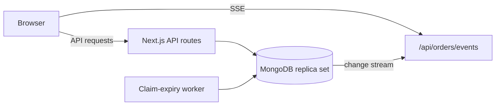
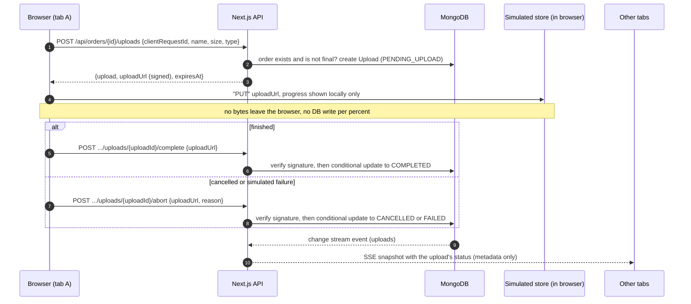
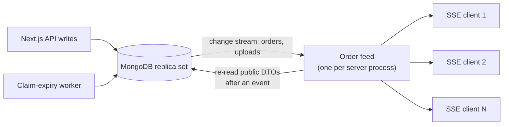

# Architecture

This document describes how the system is built. For the summary and the
quick start, see the [README](../README.md).

## Components



- **API routes** (`src/app/api/orders/**/route.ts`) handle every request:
  orders, status changes, vendor assignment, installer claims and
  verification, and upload authorization, completion and cancellation. Route
  handlers validate input with Zod and map results to HTTP. Business logic is
  in `src/lib/orders/service.ts`, `src/lib/claims/service.ts` and
  `src/lib/uploads/service.ts`. The conditional claim writes are in
  `src/lib/claims/store.mts`.
- **Live event processing also runs in the Next.js server.** The SSE route
  (`/api/orders/events`) is fed by one MongoDB change stream per server
  process (`src/lib/realtime/order-feed.ts`). It reacts to writes from any
  process and never polls the database.
- **The claim-expiry worker** (`scripts/claim-expiry-worker.mts`; the
  `worker` service in Docker and the daemon on Vercel) is a separate
  maintenance process. It only resets the stored fields of claims whose
  expiry has passed, and the change reaches every client through the change
  stream.

### Why the worker is separate, and why expiry does not depend on it

The task asks for the backend API and event processing in Next.js API routes.
**Claim expiry is enforced by the API routes, not by the worker.** The claim
and verification writes are conditional on MongoDB's clock: an expired
pending claim already counts as free to claim, and a verification for an
expired claim is rejected (`409 CLAIM_EXPIRED`). If the worker is stopped,
expiry still applies; only the cleanup of the stored fields is delayed.

The worker is a separate process because a request handler has no reliable
place for a timer: a per-claim `setTimeout` is lost on restart and duplicated
across instances, and a TTL index would delete the order. Running the sweep
inside HTTP requests would tie cleanup to traffic. Several workers may run at
once, because each release is a conditional update. This is a deliberate
reading of the task's wording, not a literal match.

## Data Model

Defined in `prisma/schema.prisma`.

### Collection `orders`

| Field | Type | Notes |
| --- | --- | --- |
| `id` | ObjectId (`_id`) | |
| `title` | string | required, trimmed, 1 to 120 characters |
| `description` | string, optional | trimmed, up to 2,000 characters; blank is stored as missing |
| `status` | `OrderStatus` enum | default `DRAFT` |
| `version` | int | default `0`; incremented on every status, vendor **or claim** change |
| `createdAt` | DateTime | default now |
| `updatedAt` | DateTime | updated on every write |
| `vendorId` | string, optional | demo vendor id (`src/lib/vendors/vendors.ts`); missing or null means no vendor |
| `claimState` | `ClaimState` enum, optional | `NONE` / `PENDING_VERIFICATION` / `CONFIRMED`; missing or null means `NONE` |
| `claimInstallerId` | string, optional | demo installer id of the current claim |
| `claimTokenHash` | string, optional | SHA-256 of the claim token; the token itself is never stored |
| `claimExpiresAt` | DateTime, optional | expiry of a pending claim; **the source of truth for expiry** |
| `claimedAt` | DateTime, optional | when the current claim was made |
| `claimConfirmedAt` | DateTime, optional | when verification passed |
| `uploadRequestIds` | string list | `clientRequestId`s of the upload attempts that hold a place under the per-order demo limit; missing means none; never returned by the API |

Indexes: `{ createdAt: -1, _id: -1 }` (list order) and
`{ claimState: 1, claimExpiresAt: 1 }` (finding expired pending claims).

**Existing documents.** All claim fields are optional on purpose: documents
written before claims existed have none of them, and Prisma cannot read a
document that lacks a required field. The code treats a missing or null
`claimState` as `NONE` (the API maps it, and the conditional writes use
`$ifNull`), so no migration is required; `db push` only adds the index. A
test inserts a document without claim fields and claims it.

Assumptions: the task does not define other order fields (customer,
dimensions, price), so none were added. Vendors are a fixed list of three
demo vendors stored by id; there is no vendor collection.

### Collection `uploads`

The `Upload` model stores print-file metadata. **File content is never
stored in MongoDB.**

| Field | Type | Notes |
| --- | --- | --- |
| `id` | ObjectId (`_id`) | generated by the server before the record is written |
| `orderId` | ObjectId | the order (checked to exist; no Prisma relation) |
| `originalName` | string | display name only, 1 to 200 characters, no path separators or control characters |
| `sizeBytes` | int64 | 1 byte to 5 GiB |
| `contentType` | string | allow-listed print format; the extension must match |
| `storageKey` | string, unique | `orders/<orderId>/<uploadId>/<random>.<ext>`; server-generated, never the file name |
| `status` | `UploadStatus` enum | `PENDING_UPLOAD`, then `COMPLETED`, `CANCELLED` or `FAILED` |
| `clientRequestId` | string | unique per order; makes authorization idempotent |
| `authorizationExpiresAt` | DateTime | validity of the signed URL (30 minutes); a `PENDING_UPLOAD` after it is shown as expired |
| `completedAt` | DateTime, optional | |
| `createdAt`, `updatedAt` | DateTime | |

Indexes: unique `storageKey`, unique `(orderId, clientRequestId)`,
`(orderId, createdAt desc)`.

### Collection `demo_limits`

The `DemoLimit` model: one document, `{ _id: "orders", seq }`, written by
every order creation to serialize the [order limit](#demo-limitations). It
holds no order data.

## Status Rules

```
DRAFT -> SUBMITTED -> VENDOR_ACCEPTED -> IN_PRODUCTION -> READY_FOR_INSTALL -> COMPLETED
DRAFT | SUBMITTED | VENDOR_ACCEPTED -> CANCELLED
```

- No skipping, no moving backwards and no same-status transitions.
- `CANCELLED` only before `IN_PRODUCTION`.
- `COMPLETED` and `CANCELLED` are final.

The rules live in `src/lib/orders/status.ts`, which has no server
dependencies. The server uses it to enforce transitions; the UI uses it to
show only the allowed actions.

**Vendor rule.** `SUBMITTED -> VENDOR_ACCEPTED` requires an assigned vendor
(`400 VENDOR_REQUIRED`). The vendor can be assigned, changed or removed only
while the order is `DRAFT` or `SUBMITTED` (`400 VENDOR_LOCKED` afterwards),
with the same `expectedVersion` conflict check as status changes. Because
every vendor change bumps `version` and the status write is conditional on
`version`, an order can never reach `VENDOR_ACCEPTED` without a vendor, even
when removal and acceptance race (tested).

**Completion does not depend on the claim or uploads.** The task does not
require a confirmed installer or an uploaded file before
`READY_FOR_INSTALL -> COMPLETED`. When an order is completed, a still
**pending** claim is released in the same atomic write (it could never be
confirmed any more); a **confirmed** claim is kept as the record of the
assigned installer. Completion and a simultaneous confirmation are both
conditional writes on the same document, so exactly one order of events
happens (tested).

Decisions on points the task leaves open: completion is not tied to a
confirmed claim or an upload; an installer may hold several jobs; a vendor is
required for `VENDOR_ACCEPTED` and locked afterwards.

## API

All responses are JSON with `Cache-Control: no-store` (the SSE stream is
`text/event-stream`). Errors have the shape
`{ "error": { "code": "...", "message": "...", "issues": [...]? } }`.

| Method and path | Body | Success |
| --- | --- | --- |
| `GET /api/orders` | none | `200 { orders, serverTime }`, newest first; `serverTime` is the MongoDB clock |
| `POST /api/orders` | `{ title, description? }` | `201 { order }`, `DRAFT`, version `0` |
| `PATCH /api/orders/[id]/status` | `{ targetStatus, expectedVersion }` | `200 { order }` |
| `PATCH /api/orders/[id]/vendor` | `{ vendorId: "<demo vendor id>" \| null, expectedVersion }` | `200 { order }` |
| `POST /api/orders/[id]/claim` | `{ installerId }` | `201 { order, claimToken }` |
| `POST /api/orders/[id]/claim/verification` | `{ installerId, claimToken, outcome: "PASSED" \| "FAILED" }` | `200 { order }` |
| `POST /api/orders/[id]/uploads` | `{ clientRequestId, originalName, sizeBytes, contentType }` | `201 { upload, uploadUrl, expiresAt }` (`200` when the same `clientRequestId` is repeated) |
| `POST /api/orders/[id]/uploads/[uploadId]/complete` | `{ uploadUrl }` | `200 { upload, changed }` (idempotent) |
| `POST /api/orders/[id]/uploads/[uploadId]/abort` | `{ uploadUrl, reason: "CANCELLED" \| "FAILED" }` | `200 { upload, changed }` (idempotent) |
| `GET /api/orders/events` | none | SSE: `snapshot` (`{ orders, serverTime }`), `heartbeat` (`{ serverTime }`) and, before the server ends the stream (after 280 s), `reconnect` |

`order.vendorId` is a demo vendor id or `null`. `order.claim` is
`{ state, installerId, expiresAt, claimedAt, confirmedAt }`. `order.uploads`
is a list of `{ id, originalName, sizeBytes, contentType, status, createdAt,
updatedAt, expiresAt, completedAt }`.

The claim token appears **only** in the `POST .../claim` response, and the
signed upload URL **only** in the `POST .../uploads` response. Neither
appears in `GET /api/orders`, other responses or the SSE stream, and neither
do token hashes, `storageKey` or `clientRequestId`. There is no endpoint
that accepts file content.

| Status | Code | When |
| --- | --- | --- |
| 400 | `INVALID_JSON` | the body is not valid JSON |
| 400 | `VALIDATION_ERROR` | invalid id; missing, invalid or unexpected fields; unknown demo installer; malformed token |
| 400 | `INVALID_TRANSITION` | the status transition breaks the rules |
| 400 | `VENDOR_REQUIRED` | `VENDOR_ACCEPTED` without an assigned vendor |
| 400 | `VENDOR_LOCKED` | vendor change after the order left `DRAFT`/`SUBMITTED` |
| 400 | `ORDER_NOT_CLAIMABLE` | claim on an order that is not `READY_FOR_INSTALL` |
| 400 | `ORDER_NOT_UPLOADABLE` | upload authorization for a completed or cancelled order |
| 403 | `UPLOAD_SIGNATURE_INVALID` | upload URL not signed by this server, modified, or belonging to another upload or order |
| 404 | `NOT_FOUND` | no order with that id |
| 409 | `VERSION_CONFLICT` | stale `expectedVersion` on a status or vendor change |
| 409 | `CLAIM_UNAVAILABLE` | someone holds an active or confirmed claim (also: the loser of a claim race) |
| 409 | `CLAIM_EXPIRED` | verification arrived at or after the claim's expiry |
| 409 | `CLAIM_NOT_ACTIVE` | token or installer does not match the current claim (released, replaced or confirmed) |
| 409 | `IDEMPOTENCY_CONFLICT` | `clientRequestId` reused for a different file |
| 409 | `DEMO_LIMIT_REACHED` | `POST /api/orders` when 200 orders exist, or `POST .../uploads` when the order already has 20 upload attempts |
| 409 | `UPLOAD_EXPIRED` | the upload authorization expired before completion or abort |
| 409 | `UPLOAD_CANCELLED` / `UPLOAD_FAILED` / `UPLOAD_ALREADY_COMPLETED` | the attempt already ended differently |
| 500 | `INTERNAL_ERROR` | unexpected failure (including a missing `UPLOAD_SIGNING_SECRET`); details are logged on the server only |

On Vercel, the WAF rule answers `429` before a request reaches the app (see
[docs/deployment.md](deployment.md#waf)).

### Atomic Status Update

`changeOrderStatus` reads the order (404), checks `expectedVersion` (409) and
the transition (400), then performs **one** conditional MongoDB `update`:
filter `{ _id, status: <status read>, version: expectedVersion }`, update
`$set status`, `$inc version`, `$currentDate updatedAt`. If it matches no
document, another request won, and the answer is 409.

`prisma.order.updateMany` is not used: with MongoDB, Prisma 6 runs it as an
aggregate that selects matching ids followed by an update filtered by `_id`
alone (seen with the MongoDB profiler), so the condition would not be part of
the write itself. Raw commands go through `prisma.$runCommandRaw`.

## Installer Claims (Optimistic Locking)

This is the task's "optimistic DB locking" option: no Redis and no
multi-document transactions. Every claim state change is a **single
conditional update** whose filter contains all preconditions, so check and
change are atomic, and every change increments `version`.

| Operation | Filter (all must hold at write time) | Change |
| --- | --- | --- |
| Claim | `status = READY_FOR_INSTALL`, and `claimState` missing or `NONE`, or `PENDING_VERIFICATION` with `claimExpiresAt <= now` | `PENDING_VERIFICATION`, installer, new token hash, `claimExpiresAt = now + 180 s`, `claimedAt = now` |
| Verification `PASSED` | `claimState = PENDING_VERIFICATION`, same installer, same token hash, `claimExpiresAt > now`, `status = READY_FOR_INSTALL` | `CONFIRMED`; token hash and expiry cleared |
| Verification `FAILED` | same as above, without the status condition | released (`NONE`, claim fields cleared) |
| Expiry release | `claimState = PENDING_VERIFICATION`, the token hash seen by the scan, `claimExpiresAt <= now` | released |

Consequences:

- **Only one active claim:** concurrent claims race on the same conditional
  update; exactly one matches and gets `201`, the others get
  `409 CLAIM_UNAVAILABLE`.
- **An expired claim is immediately claimable**, even before the worker
  releases it, because the claim filter accepts expired pending claims.
- **Old tokens are useless:** a new claim gets a new random token, and
  verification and release require the current token hash and installer.
- **Confirmed claims never expire:** `CONFIRMED` is excluded from every
  expiry condition and its expiry field is cleared.
- **The clock is MongoDB's.** Writes use `$$NOW` (the database time at write
  time), so app servers and workers with skewed clocks cannot disagree about
  expiry. A claim is active while `now < claimExpiresAt`; at the expiry
  instant it is expired. Tests pass a fixed `now` instead of `$$NOW`.
- The claim token is 32 random bytes (base64url); only its SHA-256 hash is
  stored.

### Demo Identities and Simulated Verification

- Installers are a fixed list in `src/lib/claims/installers.ts` (Alex
  Rivera, Sam Patel, Jordan Lee). The UI's **Acting as installer** selector
  (per browser tab, in `sessionStorage`) chooses one. The server only checks
  that the id is on the list. **This is not authentication or
  authorization**: anyone can send any demo id. The claim token is what ties
  verification to the tab that claimed.
- Identity and payment verification is simulated: the claiming tab shows two
  buttons, clearly marked as a demo, that send `outcome: "PASSED"` or
  `"FAILED"`. No real provider is called.
- The token is kept only in the claiming tab's memory (not in storage or the
  URL). Reloading the tab loses it; the claim then expires after three
  minutes and the job becomes available again.

### Claim-Expiry Worker

`scripts/claim-expiry-worker.mts` is a separate process: not part of the web
server, no `setTimeout` per claim and no TTL index (orders are never
deleted).

Each sweep reads MongoDB's time, finds pending claims with
`claimExpiresAt <= now` through the `(claimState, claimExpiresAt)` index (up
to 100 per batch), and releases each one with the conditional update above.
Because the write re-checks "still pending, same token, expired" at write
time, it never touches a confirmed claim or a newer claim made between the
scan and the write, and several workers can run at once (each claim is
released exactly once).

The worker stops gracefully on SIGINT, SIGTERM or SIGBREAK: the current
sweep finishes, then the database connection is closed. It is a plain Node
process (`node --env-file=.env ...`), so it cannot use the Next.js bundler or
the `@/` alias. That is why the code it shares with the API is in `.mts`
files with no app imports (`src/lib/claims/store.mts`, `constants.mts`),
imported with their extension.

## Uploads (Simulated Direct-to-Cloud)

> **This is a simulation.** No file bytes are transferred anywhere. The
> "object store" is simulated in the browser, the signed URL points to
> `https://simulated-storage.invalid` (a reserved domain that never
> resolves), and only metadata is saved. The UI says so in every upload
> dialog and marks the 1.5 GB demo file as "Demo · no content".

The task asks to *simulate* direct-to-cloud uploads of "1GB+" print files
with pre-signed URLs, so no real storage is integrated.



**Signed URL.** HMAC-SHA256 with `UPLOAD_SIGNING_SECRET` (server-side only)
over: version, operation (`PUT`), upload id, order id, `storageKey`, exact
size, content type and expiry. Changing any of them, using another upload's
URL or another order's path gives `403 UPLOAD_SIGNATURE_INVALID`; the
signature is compared in constant time. Completion and abort require the
signed URL of exactly that upload, so only the browser that received it can
finish or cancel that attempt.

**Rules.**

- **Final orders:** a **new** upload attempt is refused when the order is
  `COMPLETED` or `CANCELLED` at the time of the request. Uploads live in their
  own collection (no multi-document transaction), so an attempt authorized
  *before* the order became final may still complete or be aborted
  afterwards. This is the defined behavior, not a guarantee that a final
  order never gets a file (tested).
- Limits: 1 byte to 5 GiB (the single pre-signed `PUT` limit of common object
  stores; larger files would need multipart uploads), names up to 200
  characters without path separators or control characters, and
  allow-listed print formats (PDF, TIFF, PNG, JPEG, SVG, EPS/AI, PSD) whose
  extension must match the type.
- The `storageKey` is generated by the server; the file name is display
  metadata only.
- Authorization is idempotent per `clientRequestId` (one id per "Start
  upload" action): a double click returns the same attempt. "Try again"
  creates a new attempt with a new id; the failed one stays `FAILED`.
- Completion and abort are single conditional writes (`PENDING_UPLOAD` and
  not expired at write time, on MongoDB's clock). Repeating the same outcome
  is idempotent (`changed: false`). Completing a cancelled or failed attempt,
  cancelling a completed one, or anything after expiry is refused. A request
  for an old attempt cannot affect a newer one (different id and signature).
- Upload progress is local to the uploading tab (the task's "optimistic UI"
  option). Other tabs see only persisted metadata and status, pushed via SSE.
- Uploads are not tied to the order status flow (not required by the task),
  and there is no download button, because no file exists.

**Limits of the simulation and how real storage would replace it.**

- *A completion report from the browser is not proof that the file exists.*
  Here the server accepts it after checking the signature and state. With a
  real object store (S3, GCS, Azure Blob), the server would instead check the
  object itself before marking it `COMPLETED`, for example with `HeadObject`
  on `storageKey` to confirm it exists with the exact signed size and type
  (and optionally a checksum), or mark it complete from a verified storage
  event (such as an S3 `ObjectCreated` notification). The signed URL itself
  would be created by the provider SDK (for example
  `getSignedUrl(PutObjectCommand)`), with the content length and type part
  of the signature, and the store, not this server, would enforce the
  signature on the `PUT`.
- The browser side is `DirectUploadAdapter` in
  `src/lib/uploads/simulated-storage.ts`; a real adapter would `PUT` the
  `File` to `uploadUrl` with `XMLHttpRequest` (for progress events). The
  simulated adapter never reads file content: for a chosen file only its
  name, size and type are used, and the demo file has no content at all.
- Abandoned `PENDING_UPLOAD` attempts are not swept; after
  `authorizationExpiresAt` they are shown as expired and can no longer be
  completed. A real store would also need a lifecycle rule for incomplete
  objects.

## Live Updates (Change Streams and SSE)

`GET /api/orders/events` streams `snapshot` events (`{ orders, serverTime }`)
and `heartbeat` events (`{ serverTime }`). Snapshots are pushed by MongoDB
Change Streams; nothing polls the database.



`src/lib/realtime/order-feed.ts`:

- **One change stream per server process**, shared by all SSE clients,
  opened when the first client connects and closed (together with its
  `MongoClient`) when the last one leaves. It watches the `orders` and
  `uploads` collections, so writes from any process (this app, the worker,
  other instances) arrive as events.
- **An event only means "something changed".** The feed then re-reads the
  snapshot through Prisma (public DTOs only; raw documents, token hashes,
  `storageKey` and signed URLs are never sent) and pushes it to all clients
  if it differs from the last one. Events that arrive while a read is running
  are coalesced into one more read. Reads happen only after events or
  (re)connects, never on a timer (an integration test asserts this).
- **Start-up race:** the stream is opened and its cursor established
  (`tryNext()`) *before* the first snapshot is read, so no write can fall
  between the snapshot and the stream. A client that connects later gets the
  cached snapshot immediately, then every change.
- **Failures:** the driver resumes transient errors itself. If the stream
  still fails, the feed reopens it with exponential backoff
  (`REALTIME_RETRY_BASE_MS`, default 1 s, max 30 s), **resuming after the
  last resume token**, which replays the changes it missed. If the server
  rejects the token (for example when it is no longer in the oplog), the
  feed reopens without it and performs a **full re-sync**.
- **Heartbeats** every `SSE_HEARTBEAT_MS` (default 15 s) keep proxies from
  closing idle connections and refresh the client's clock offset. They never
  query the database: `serverTime` is estimated from the last snapshot's
  MongoDB time plus this process's monotonic clock.
- **Clients:** a new or reconnecting client always starts with the current
  snapshot, so it never keeps stale data. `EventSource` retries by itself
  (`retry: 3000`); if it gives up, the client reconnects with backoff. The UI
  shows **Live** or **Reconnecting…**.
- **Stream lifetime:** the route exports `maxDuration = 300` (the Vercel
  Hobby maximum, which also applies to streamed responses). Each stream ends
  itself 20 s earlier: the server sends a `reconnect` event and runs its
  normal cleanup, and the client reconnects at once without showing
  *Reconnecting…*. This also applies in the Docker run (one short reconnect
  every 280 s).
- **Merging on the client** (`src/lib/orders/merge.ts`): SSE snapshots, GET
  responses and mutation responses can arrive out of order. Per order the
  higher `version` wins. Uploads are merged separately (union by id, and an
  upload never moves back from a final status to pending), because upload
  changes do not bump `order.version`.
- **Feed restarts:** when the last client leaves, the feed stops. A client
  that connects right after (for example after a page reload) gets a fresh
  initial snapshot, even if a read from the stopped feed was still running
  (regression-tested).
- **Cleanup:** on disconnect the subscription and heartbeat interval are
  removed. With no clients left there is no change stream, database client,
  retry timer or interval (tests check the feed state and the process's
  active timers).

Limitations: each server process opens its own change stream, and each event
re-reads the whole (unpaginated) order list, which is fine for this dataset
size. Change Streams require a replica set (already used). The snapshot cache
is per process and is dropped when the last client leaves.

## User Interface

`src/app/page.tsx` renders a static shell; `src/components/orders/` loads the
list in the browser (initial `GET`, then SSE), so the page build never needs
the database.

- Order list with status, creation date and, for orders ready for install
  (or with a confirmed installer), a claim line: *Open for installers*,
  *Claimed by … · awaiting verification · m:ss left*, *…'s claim expired ·
  open for installers*, or *Installer: … · verified*.
- **Installer assignment** dialog (per order ready for install): claim as the
  acting installer, see who holds the claim and the countdown, and, in the
  claiming tab only, the **Verification simulation (demo)** buttons.
- The countdown uses the server's expiry and the measured offset between the
  local clock and the database clock (`serverTime`). A pending claim is shown
  as expired from its expiry instant, even before the worker runs, and the
  claiming tab gets an expiry message.
- Clear messages for a lost claim race (409), expiry, failed verification and
  status conflicts. Buttons are disabled while a request is in flight.
  Outcome messages in the assignment dialog are tied to the claim they
  describe and disappear once the latest data shows a different claim.
- **Print files** dialog (per order): choose a file (only name, size and type
  are used) or the 1.5 GB demo file, optionally simulate a network failure,
  start, watch local progress, cancel and try again. It lists every attempt
  of the order with its persisted status.
- **Vendor** dialog (per `DRAFT`/`SUBMITTED` order): pick one of the demo
  vendors or none. *Mark vendor accepted* stays disabled, with a hint, until a
  vendor is assigned.
- **New order** and **Change status** dialogs.

## Demo Limitations

**Demo identities are not permissions.** Installers and vendors are a fixed
demo list chosen in the browser, and the server only checks that an id is on
the list. There is no login, so **anyone who can open the site can change the
demo data**:

- read every order, create orders, change any order's status (including
  cancelling or completing it) and assign vendors;
- claim any ready job as any demo installer (verification still needs the
  claim token, which only the claiming tab has);
- start simulated uploads on any order that is not final.

**Data limits** (`src/lib/demo-limits.mts`), because every live update
re-reads and sends the whole order list:

| Limit | Enforcement | Refusal |
| --- | --- | --- |
| **200 orders** in the database | `createOrder` (`src/lib/orders/service.ts`): one MongoDB transaction writes the shared `demo_limits` document, counts the orders and inserts. Concurrent creations write the same document, so MongoDB aborts all but one (write conflict) and they retry with a fresh count. The count is of the real orders, so deleting orders frees places. | `409 DEMO_LIMIT_REACHED`, shown in the *New order* dialog |
| **20 upload attempts per order**, including failed, cancelled and expired ones | `authorizeUpload` (`src/lib/uploads/service.ts`): one conditional update adds the request's `clientRequestId` to the order's `uploadRequestIds` only if it is already there or fewer than 20 are. Repeating a request (a double click, a retry) uses the same place and returns the same attempt; places are never given back. | `409 DEMO_LIMIT_REACHED`, shown in the *Print files* dialog; the dialog also disables *Start upload* once the order lists 20 attempts |

Both are covered by `tests/integration/demo-limits.test.ts` (parallel
requests for the last places, repeated requests at the limit) and by the UI
check (both messages in the dialogs).

**What the limits do not do.** They bound stored data only. They do not limit
the number of requests, open SSE connections or data transfer, so a client
can still use up the host's and the database's quotas (function time and
memory, bandwidth, database operations per second). On free plans that can
mean throttling or a feature being blocked for the rest of the billing
period, not a bill. The WAF rule in the deployment limits the write rate only
and does not guarantee that quotas cannot be exhausted (see
[docs/deployment.md](deployment.md#waf)).

## Task Requirement Coverage

Kind: E = explicit requirement, G = general wording, A = assumption made
here.

| Requirement | Kind | Where | Verified by | Remaining gap |
| --- | --- | --- | --- | --- |
| Next.js App Router, MongoDB with Prisma, Tailwind with shadcn, TypeScript | E | whole repository | `npm run check` | none |
| Backend API and event processing in API routes | E | `src/app/api/orders/**`, change stream to SSE in the Next.js server | integration, UI check | claim-expiry cleanup runs in a separate worker; expiry is enforced by the API ([Components](#components)) |
| State machine `DRAFT` to `COMPLETED`, enforced in the UI **and** the backend | E | `src/lib/orders/status.ts`, status route, Change status dialog | unit (all 49 pairs), integration, UI check | none |
| `CANCELLED` only before `IN_PRODUCTION`; invalid jumps blocked with UI feedback and HTTP 400 | E | same | unit and integration (`400 INVALID_TRANSITION`) | the UI offers only allowed actions, so the 400 is mostly exercised at API level |
| "manage … vendor assignments" | G | `src/lib/vendors`, vendor route, Vendor dialog | integration (`vendors.test.ts`), UI check | minimal: fixed demo vendors, no vendor accounts |
| Concurrency: several installers accept, exactly one is assigned (Redis or optimistic DB lock) | E | `src/lib/claims/store.mts` (conditional update) | integration (2 and 12 parallel claims), two-window UI check | none |
| Release the lock if identity or payment verification fails within 3 minutes | E | claim expiry (`claimExpiresAt`), `FAILED` verification, worker | integration (injected clock, worker process), UI check, manual cloud check | verification is simulated (demo buttons) |
| Simulate direct-to-cloud upload of 1GB+ files with pre-signed URLs | E | `src/lib/uploads/*`, upload routes, Print files dialog | unit (signing, 5 GiB simulation), integration, UI check | simulated store; completion is reported by the browser |
| Real-time upload progress via WS / SSE / optimistic UI, without repeated DB polling | E | local progress (optimistic UI) plus Change Streams to SSE | integration (no reads while idle; two clients), UI check | other tabs see status, not per-percent progress (A) |
| Real-time order lifecycle tracking; indicators for state changes, uploads and claims | E/G | SSE feed, Live indicator, row claim and upload lines | SSE integration tests, UI check | none |
| Interactive modals: Order Creation, Status Transitions, Installer Assignment | E | the three dialogs | UI check | none |
| Responsive (mobile, tablet, desktop) | E | Tailwind layout | see [manual local checks](development-and-testing.md#3-manual-local-checks) | at 768 px the dashboard and the other dialogs were checked manually only, before the last *Print files* width fix |
| Repository with docker-compose (`docker-compose.yml` preferred) | E | `docker-compose.yml`, `Dockerfile` | local Docker acceptance run | none |
| README: database schema, lock strategy, upload pipeline | E | [README](../README.md) and this document | none | none |
| Live deployment URL | E | https://sign-flow-flame.vercel.app (protected; the access link is provided separately) | manual cloud check ([docs/deployment.md](deployment.md#cloud-check-results)) | none |
