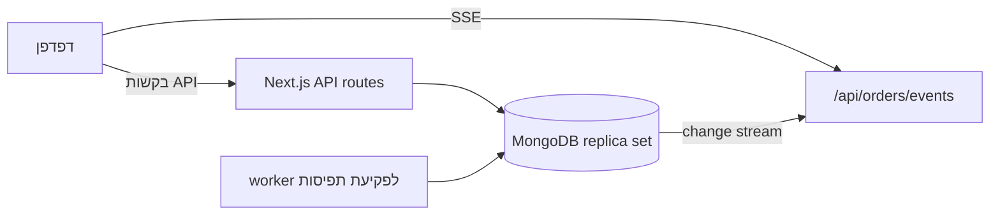
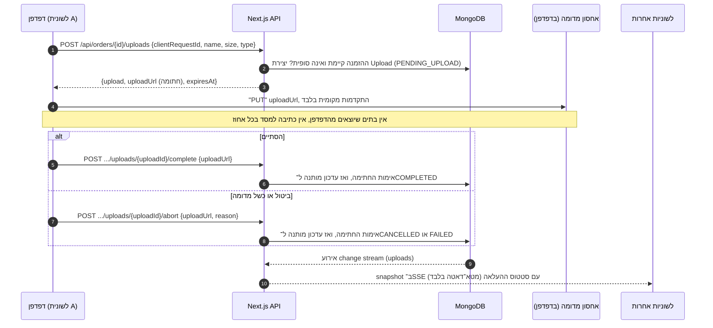
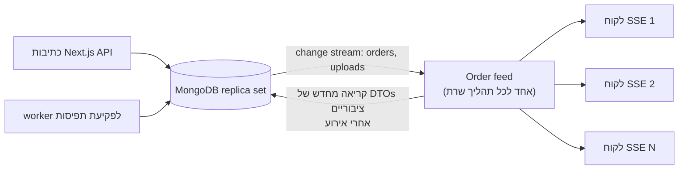

# ארכיטקטורה

מסמך זה מפרט את מבנה המערכת. לתקציר ולהוראות ההרצה ראו את
[README](../README.md).

## רכיבים



- **API routes** (`src/app/api/orders/**/route.ts`) מטפלים בכל בקשה: הזמנות,
  שינויי סטטוס, שיוך ספקים, תפיסות ואימות, והרשאה, השלמה וביטול של העלאות.
  ה־route מאמת קלט עם Zod וממפה תוצאות ל־HTTP. הלוגיקה העסקית נמצאת
  ב־`src/lib/orders/service.ts`, ב־`src/lib/claims/service.ts`
  וב־`src/lib/uploads/service.ts`. הכתיבות המותנות של התפיסות נמצאות
  ב־`src/lib/claims/store.mts`.
- **עיבוד האירועים החיים רץ גם הוא בשרת Next.js**: נתיב ה־SSE
  (`/api/orders/events`) מוזן מ־change stream אחד לכל תהליך שרת
  (`src/lib/realtime/order-feed.ts`). הוא מגיב לכתיבות מכל תהליך, ולעולם אינו
  מתשאל את המסד בלולאה.
- **ה־worker לפקיעת תפיסות** (`scripts/claim-expiry-worker.mts`, השירות
  `worker` ב־Docker וה־daemon ב־Vercel) הוא תהליך תחזוקה נפרד. הוא רק מאפס את
  השדות השמורים של תפיסות שפקעו, והשינוי מגיע לכל הלקוחות דרך ה־change stream.

### למה ה־worker נפרד, ולמה הפקיעה אינה תלויה בו

המשימה מבקשת שה־API ועיבוד האירועים ירוצו ב־Next.js API routes. **פקיעת
התפיסה נאכפת ב־API routes, לא ב־worker**: כתיבות התפיסה והאימות מותנות בשעון
של MongoDB. תפיסה ממתינה שפקעה כבר נחשבת פנויה לתפיסה, ואימות של תפיסה שפקעה
נדחה (`409 CLAIM_EXPIRED`). אם ה־worker עצור, הפקיעה עדיין חלה, ורק ניקוי
השדות השמורים מתעכב.

ה־worker נפרד מפני שלמטפל בבקשה אין מקום אמין לטיימר. `setTimeout` לכל תפיסה
אובד בהפעלה מחדש ומשוכפל בין מופעים, ואינדקס TTL היה מוחק את ההזמנה. הרצת
הסריקה בתוך בקשות HTTP הייתה קושרת את הניקוי לתעבורה. כמה workers יכולים
לרוץ במקביל, כי כל שחרור הוא עדכון מותנה. זו פרשנות מכוונת של נוסח המשימה,
ולא התאמה מילולית.

## מודל הנתונים

`prisma/schema.prisma`.

### האוסף `orders`

| שדה | סוג | הערות |
| --- | --- | --- |
| `id` | ObjectId (`_id`) | |
| `title` | string | חובה, ללא רווחים בקצוות, 1 עד 120 תווים |
| `description` | string, אופציונלי | ללא רווחים בקצוות, עד 2,000 תווים. ערך ריק נשמר כחסר |
| `status` | enum `OrderStatus` | ברירת מחדל `DRAFT` |
| `version` | int | ברירת מחדל `0`. עולה בכל שינוי סטטוס, ספק **או תפיסה** |
| `createdAt` | DateTime | ברירת מחדל: עכשיו |
| `updatedAt` | DateTime | מתעדכן בכל כתיבה |
| `vendorId` | string, אופציונלי | מזהה ספק דמו (`src/lib/vendors/vendors.ts`). חסר או null: אין ספק |
| `claimState` | enum `ClaimState`, אופציונלי | `NONE` / `PENDING_VERIFICATION` / `CONFIRMED`. חסר או null פירושו `NONE` |
| `claimInstallerId` | string, אופציונלי | מזהה מתקין הדמו של התפיסה הנוכחית |
| `claimTokenHash` | string, אופציונלי | SHA-256 של אסימון התפיסה. האסימון עצמו לעולם אינו נשמר |
| `claimExpiresAt` | DateTime, אופציונלי | מועד הפקיעה של תפיסה ממתינה. **מקור האמת לפקיעה** |
| `claimedAt` | DateTime, אופציונלי | מועד התפיסה הנוכחית |
| `claimConfirmedAt` | DateTime, אופציונלי | מועד שבו האימות עבר |
| `uploadRequestIds` | רשימת strings | ה־`clientRequestId` של ניסיונות ההעלאה שתופסים מקום במגבלת ההדגמה. חסר: אין. לעולם אינו מוחזר ב־API |

אינדקסים: `{ createdAt: -1, _id: -1 }` (סדר הרשימה) ו־
`{ claimState: 1, claimExpiresAt: 1 }` (איתור תפיסות ממתינות שפקעו).

**מסמכים קיימים.** כל שדות התפיסה אופציונליים בכוונה: מסמכים שנכתבו לפני
שהתפיסות נוספו אינם מכילים אותם, ו־Prisma אינו יכול לקרוא מסמך שחסר בו שדה
חובה. הקוד מתייחס ל־`claimState` חסר או null כאל `NONE` (ה־API ממפה אותו,
והכתיבות המותנות משתמשות ב־`$ifNull`), ולכן לא נדרשת מיגרציה. `db push` רק
מוסיף את האינדקס. בדיקה מכניסה מסמך ללא שדות תפיסה ותופסת אותו.

הנחות: המשימה אינה מגדירה שדות הזמנה נוספים (לקוח, מידות, מחיר), ולכן לא
נוספו. הספקים הם רשימה קבועה של שלושה ספקי דמו שנשמרים לפי מזהה, ואין אוסף
ספקים.

### האוסף `uploads`

המודל `Upload` שומר מטא־דאטה של קבצי הדפסה. **תוכן קבצים לעולם אינו נשמר
ב־MongoDB.**

| שדה | סוג | הערות |
| --- | --- | --- |
| `id` | ObjectId (`_id`) | נוצר בשרת לפני כתיבת הרשומה |
| `orderId` | ObjectId | ההזמנה (נבדק שהיא קיימת, ללא קשר Prisma) |
| `originalName` | string | שם לתצוגה בלבד, 1 עד 200 תווים, ללא מפרידי נתיב ותווי בקרה |
| `sizeBytes` | int64 | מבית אחד עד 5 GiB |
| `contentType` | string | פורמט הדפסה מרשימה מותרת. הסיומת חייבת להתאים |
| `storageKey` | string, ייחודי | `orders/<orderId>/<uploadId>/<random>.<ext>`. נוצר בשרת, לעולם אינו שם הקובץ |
| `status` | enum `UploadStatus` | `PENDING_UPLOAD` ואחריו `COMPLETED`, `CANCELLED` או `FAILED` |
| `clientRequestId` | string | ייחודי להזמנה. הופך את ההרשאה לאידמפוטנטית |
| `authorizationExpiresAt` | DateTime | תוקף הכתובת החתומה (30 דקות). `PENDING_UPLOAD` אחריו מוצג כפג תוקף |
| `completedAt` | DateTime, אופציונלי | |
| `createdAt`, `updatedAt` | DateTime | |

אינדקסים: ייחודי `storageKey`, ייחודי `(orderId, clientRequestId)`,
`(orderId, createdAt desc)`.

### האוסף `demo_limits`

המודל `DemoLimit`: מסמך אחד, `{ _id: "orders", seq }`, שכל יצירת הזמנה כותבת
אליו כדי לסדר את [מגבלת ההזמנות](#מגבלות-ההדגמה). הוא אינו מכיל נתוני
הזמנות.

## כללי הסטטוס

```
DRAFT -> SUBMITTED -> VENDOR_ACCEPTED -> IN_PRODUCTION -> READY_FOR_INSTALL -> COMPLETED
DRAFT | SUBMITTED | VENDOR_ACCEPTED -> CANCELLED
```

- אין דילוג, אין חזרה אחורה ואין מעבר לאותו סטטוס.
- `CANCELLED` רק לפני `IN_PRODUCTION`.
- `COMPLETED` ו־`CANCELLED` סופיים.

הכללים נמצאים ב־`src/lib/orders/status.ts`, שאין לו תלויות בשרת. השרת משתמש
בו כדי לאכוף מעברים, והממשק משתמש בו כדי להציג רק את הפעולות המותרות.

**כלל הספק.** המעבר `SUBMITTED -> VENDOR_ACCEPTED` דורש ספק משויך
(`400 VENDOR_REQUIRED`). אפשר לשייך, להחליף או להסיר ספק רק כל עוד ההזמנה
`DRAFT` או `SUBMITTED` (אחר כך `400 VENDOR_LOCKED`), עם אותה בדיקת התנגשות
`expectedVersion` כמו בשינויי סטטוס. כל שינוי ספק מעלה את `version`, וכתיבת
הסטטוס מותנית ב־`version`, ולכן הזמנה לעולם אינה מגיעה ל־`VENDOR_ACCEPTED`
ללא ספק, גם כשהסרה ואישור מתרחשים במקביל (נבדק).

**השלמה אינה תלויה בתפיסה או בהעלאות.** המשימה אינה דורשת מתקין מאושר או
קובץ שהועלה לפני `READY_FOR_INSTALL -> COMPLETED`. כשהזמנה מושלמת, תפיסה
**ממתינה** משתחררת באותה כתיבה אטומית (היא כבר לא תוכל להיות מאושרת), ותפיסה
**מאושרת** נשמרת כתיעוד של המתקין שהוקצה. השלמה ואישור בו־זמניים הם שתי
כתיבות מותנות על אותו מסמך, ולכן מתרחש בדיוק סדר אירועים אחד (נבדק).

החלטות בנקודות שהמשימה משאירה פתוחות: השלמה אינה קשורה לתפיסה מאושרת או
להעלאה, מתקין יכול להחזיק כמה עבודות, וספק נדרש ל־`VENDOR_ACCEPTED` וננעל
לאחר מכן.

## API

כל התשובות הן JSON עם `Cache-Control: no-store` (זרם ה־SSE הוא
`text/event-stream`). מבנה השגיאה:
`{ "error": { "code": "...", "message": "...", "issues": [...]? } }`.

| שיטה ונתיב | גוף הבקשה | הצלחה |
| --- | --- | --- |
| `GET /api/orders` | אין | `200 { orders, serverTime }`, מהחדשה לישנה. `serverTime` הוא שעון MongoDB |
| `POST /api/orders` | `{ title, description? }` | `201 { order }`, `DRAFT`, version `0` |
| `PATCH /api/orders/[id]/status` | `{ targetStatus, expectedVersion }` | `200 { order }` |
| `PATCH /api/orders/[id]/vendor` | `{ vendorId: "<demo vendor id>" \| null, expectedVersion }` | `200 { order }` |
| `POST /api/orders/[id]/claim` | `{ installerId }` | `201 { order, claimToken }` |
| `POST /api/orders/[id]/claim/verification` | `{ installerId, claimToken, outcome: "PASSED" \| "FAILED" }` | `200 { order }` |
| `POST /api/orders/[id]/uploads` | `{ clientRequestId, originalName, sizeBytes, contentType }` | `201 { upload, uploadUrl, expiresAt }` (`200` כשאותו `clientRequestId` חוזר) |
| `POST /api/orders/[id]/uploads/[uploadId]/complete` | `{ uploadUrl }` | `200 { upload, changed }` (אידמפוטנטי) |
| `POST /api/orders/[id]/uploads/[uploadId]/abort` | `{ uploadUrl, reason: "CANCELLED" \| "FAILED" }` | `200 { upload, changed }` (אידמפוטנטי) |
| `GET /api/orders/events` | אין | SSE: אירועי `snapshot` (`{ orders, serverTime }`), `heartbeat` (`{ serverTime }`), ולפני שהשרת סוגר את הזרם (אחרי 280 שניות) `reconnect` |

`order.vendorId` הוא מזהה ספק דמו או `null`. `order.claim` הוא
`{ state, installerId, expiresAt, claimedAt, confirmedAt }`. `order.uploads` היא
רשימה של `{ id, originalName, sizeBytes, contentType, status, createdAt,
updatedAt, expiresAt, completedAt }`.

אסימון התפיסה מופיע **רק** בתשובה ל־`POST .../claim`, והכתובת החתומה **רק**
בתשובה ל־`POST .../uploads`. הם לעולם אינם מופיעים ב־`GET /api/orders`,
בתשובות אחרות או בזרם ה־SSE, וכך גם גיבובי אסימונים, `storageKey`
ו־`clientRequestId`. אין נקודת קצה שמקבלת תוכן קבצים.

| סטטוס | קוד | מתי |
| --- | --- | --- |
| 400 | `INVALID_JSON` | הגוף אינו JSON תקין |
| 400 | `VALIDATION_ERROR` | מזהה לא תקין, שדות חסרים, לא תקינים או לא צפויים, מתקין דמו לא מוכר, אסימון פגום |
| 400 | `INVALID_TRANSITION` | מעבר הסטטוס מפר את הכללים |
| 400 | `VENDOR_REQUIRED` | `VENDOR_ACCEPTED` ללא ספק משויך |
| 400 | `VENDOR_LOCKED` | שינוי ספק אחרי שההזמנה עזבה את `DRAFT`/`SUBMITTED` |
| 400 | `ORDER_NOT_CLAIMABLE` | תפיסה של הזמנה שאינה `READY_FOR_INSTALL` |
| 400 | `ORDER_NOT_UPLOADABLE` | הרשאת העלאה להזמנה שהושלמה או בוטלה |
| 403 | `UPLOAD_SIGNATURE_INVALID` | כתובת העלאה שלא נחתמה בשרת הזה, ששונתה, או ששייכת להעלאה או להזמנה אחרת |
| 404 | `NOT_FOUND` | אין הזמנה עם המזהה הזה |
| 409 | `VERSION_CONFLICT` | `expectedVersion` ישן בשינוי סטטוס או ספק |
| 409 | `CLAIM_UNAVAILABLE` | מישהו מחזיק תפיסה פעילה או מאושרת (גם: המפסיד במרוץ תפיסה) |
| 409 | `CLAIM_EXPIRED` | האימות של התפיסה הגיע ברגע הפקיעה או אחריו |
| 409 | `CLAIM_NOT_ACTIVE` | האסימון או המתקין אינם תואמים לתפיסה הנוכחית (שוחררה, הוחלפה או אושרה) |
| 409 | `IDEMPOTENCY_CONFLICT` | `clientRequestId` שומש שוב עבור קובץ אחר |
| 409 | `DEMO_LIMIT_REACHED` | `POST /api/orders` כשיש 200 הזמנות, או `POST .../uploads` כשלהזמנה כבר 20 ניסיונות העלאה |
| 409 | `UPLOAD_EXPIRED` | הרשאת ההעלאה פגה לפני ההשלמה או הביטול |
| 409 | `UPLOAD_CANCELLED` / `UPLOAD_FAILED` / `UPLOAD_ALREADY_COMPLETED` | הניסיון כבר הסתיים אחרת |
| 500 | `INTERNAL_ERROR` | כשל לא צפוי (כולל `UPLOAD_SIGNING_SECRET` חסר). הפרטים נרשמים בשרת בלבד |

בפריסה ב־Vercel, כלל ה־WAF מחזיר `429` לפני שהבקשה מגיעה לאפליקציה (ראו
[docs/deployment.md](deployment.md)).

### עדכון סטטוס אטומי

`changeOrderStatus` קורא את ההזמנה (404), בודק את `expectedVersion` (409) ואת
המעבר (400), ואז מבצע `update` מותנה **אחד** ב־MongoDB: הסינון
`{ _id, status: <status read>, version: expectedVersion }`, והעדכון `$set status`,
`$inc version`, `$currentDate updatedAt`. אם אף מסמך אינו מתאים, בקשה אחרת
הקדימה, והתשובה היא 409.

`prisma.order.updateMany` אינו בשימוש: מול MongoDB, Prisma 6 מריץ אותו
כ־aggregate שבוחר מזהים ואחריו עדכון שמסונן לפי `_id` בלבד (נצפה ב־profiler של
MongoDB), כך שהתנאי לא היה חלק מהכתיבה עצמה. פקודות גולמיות עוברות דרך
`prisma.$runCommandRaw`.

## תפיסת מתקינים (נעילה אופטימית)

זו אפשרות "optimistic DB locking" מהמשימה: ללא Redis וללא טרנזקציות מרובות
מסמכים. כל שינוי במצב התפיסה הוא **עדכון מותנה אחד** שהסינון שלו כולל את כל
התנאים המוקדמים, כך שהבדיקה והשינוי אטומיים, וכל שינוי מעלה את `version`.

| פעולה | הסינון (כל התנאים חייבים להתקיים בזמן הכתיבה) | השינוי |
| --- | --- | --- |
| תפיסה | `status = READY_FOR_INSTALL`, וגם `claimState` חסר או `NONE`, או `PENDING_VERIFICATION` עם `claimExpiresAt <= now` | `PENDING_VERIFICATION`, מתקין, גיבוב אסימון חדש, `claimExpiresAt = now + 180 s`, `claimedAt = now` |
| אימות `PASSED` | `claimState = PENDING_VERIFICATION`, אותו מתקין, אותו גיבוב אסימון, `claimExpiresAt > now`, `status = READY_FOR_INSTALL` | `CONFIRMED`, גיבוב האסימון ומועד הפקיעה מנוקים |
| אימות `FAILED` | כמו בשורה הקודמת, ללא תנאי הסטטוס | שחרור (`NONE`, שדות התפיסה מנוקים) |
| שחרור בפקיעה | `claimState = PENDING_VERIFICATION`, גיבוב האסימון שנראה בסריקה, `claimExpiresAt <= now` | שחרור |

השלכות:

- **רק תפיסה פעילה אחת:** תפיסות מקבילות מתחרות על אותו עדכון מותנה. בדיוק
  אחת מתאימה ומקבלת `201`, והשאר מקבלות `409 CLAIM_UNAVAILABLE`.
- **תפיסה שפקעה ניתנת לתפיסה מיד**, עוד לפני שה־worker משחרר אותה, כי סינון
  התפיסה מקבל תפיסות ממתינות שפקעו.
- **אסימונים ישנים חסרי ערך:** תפיסה חדשה מקבלת אסימון אקראי חדש, ואימות
  ושחרור דורשים את גיבוב האסימון ואת המתקין הנוכחיים.
- **תפיסות מאושרות לעולם אינן פוקעות:** `CONFIRMED` מוחרג מכל תנאי פקיעה,
  ומועד הפקיעה שלו מנוקה.
- **השעון הוא של MongoDB.** הכתיבות משתמשות ב־`$$NOW` (זמן המסד בזמן הכתיבה),
  כך ששרתי אפליקציה ו־workers עם סטיית שעון אינם חלוקים על הפקיעה. תפיסה
  פעילה כל עוד `now < claimExpiresAt`, וברגע הפקיעה היא כבר פגה. הבדיקות
  מעבירות `now` קבוע במקום `$$NOW`.
- אסימון התפיסה הוא 32 בתים אקראיים (base64url), ונשמר רק גיבוב ה־SHA-256 שלו.

### זהויות דמו ואימות מדומה

- המתקינים הם רשימה קבועה ב־`src/lib/claims/installers.ts` (Alex Rivera,
  Sam Patel, Jordan Lee). הבורר **Acting as installer** בממשק (לכל לשונית,
  ב־`sessionStorage`) בוחר אחד מהם. השרת בודק רק שהמזהה ברשימה. **זה אינו
  אימות או הרשאה**: כל אחד יכול לשלוח כל מזהה דמו. אסימון התפיסה הוא שקושר את
  האימות ללשונית שתפסה.
- אימות הזהות או התשלום מדומה: הלשונית שתפסה מציגה שני כפתורים, מסומנים
  בבירור כדמו, ששולחים `outcome: "PASSED"` או `"FAILED"`. אין קריאה לספק אמיתי.
- האסימון נשמר רק בזיכרון של הלשונית שתפסה (לא באחסון ולא בכתובת). רענון
  הלשונית מאבד אותו, והתפיסה פוקעת לאחר שלוש דקות והעבודה חוזרת לזמינות.

### ה־worker לפקיעת תפיסות

`scripts/claim-expiry-worker.mts` הוא תהליך נפרד (לא חלק משרת האינטרנט, ללא
`setTimeout` לכל תפיסה וללא אינדקס TTL, כי הזמנות לעולם אינן נמחקות).

כל סריקה קוראת את זמן MongoDB, מוצאת תפיסות ממתינות עם `claimExpiresAt <= now`
דרך האינדקס `(claimState, claimExpiresAt)` (עד 100 בכל אצווה), ומשחררת כל
אחת בעדכון המותנה שבטבלה. הכתיבה בודקת מחדש "עדיין ממתינה, אותו אסימון,
פקעה", ולכן לעולם אינה נוגעת בתפיסה מאושרת או בתפיסה חדשה שנוצרה בין הסריקה
לכתיבה, וכמה workers יכולים לרוץ יחד (כל תפיסה משתחררת פעם אחת בדיוק).

ה־worker נעצר בצורה מסודרת ב־SIGINT, SIGTERM או SIGBREAK: הסריקה הנוכחית
מסתיימת, ואז החיבור למסד נסגר. הוא תהליך Node רגיל (`node --env-file=.env ...`),
ולכן אינו יכול להשתמש ב־bundler של Next.js או בכינוי `@/`. לכן הקוד שהוא חולק
עם ה־API נמצא בקובצי `.mts` ללא ייבוא מהאפליקציה
(`src/lib/claims/store.mts`, `constants.mts`), שמיובאים עם הסיומת.

## העלאות (הדמיה של העלאה ישירה לענן)

> **זו הדמיה.** אף בית של קובץ אינו מועבר לשום מקום. "אחסון האובייקטים" מדומה
> בדפדפן, הכתובת החתומה מפנה ל־`https://simulated-storage.invalid` (דומיין
> שמור שלעולם אינו נפתר), ורק מטא־דאטה נשמר. הממשק אומר זאת בכל חלונית העלאה,
> ומסמן את קובץ הדמו של 1.5 GB כ־"Demo · no content".

המשימה מבקשת *להדמות* העלאה ישירה לענן של קבצי הדפסה של "1GB+" עם כתובות
חתומות מראש, ולכן לא שולב אחסון אמיתי.



**הכתובת החתומה.** HMAC-SHA256 עם `UPLOAD_SIGNING_SECRET` (בצד השרת בלבד) על:
גרסה, פעולה (`PUT`), מזהה העלאה, מזהה הזמנה, `storageKey`, הגודל המדויק, סוג
התוכן ומועד התפוגה. שינוי של כל אחד מהם, שימוש בכתובת של העלאה אחרת או בנתיב
של הזמנה אחרת מחזירים `403 UPLOAD_SIGNATURE_INVALID`, וההשוואה נעשית בזמן
קבוע. השלמה וביטול דורשים את הכתובת החתומה של אותה העלאה בדיוק, ולכן רק
הדפדפן שקיבל אותה יכול לסיים או לבטל את הניסיון.

**כללים.**

- **הזמנות סופיות:** ניסיון העלאה **חדש** נדחה כשההזמנה `COMPLETED` או
  `CANCELLED` בזמן הבקשה. ההעלאות שמורות באוסף משלהן (ללא טרנזקציה מרובת
  מסמכים), ולכן ניסיון שקיבל הרשאה *לפני* שההזמנה הפכה לסופית עדיין יכול
  להסתיים או להתבטל אחר כך. זו ההתנהגות המוגדרת, ולא הבטחה שהזמנה סופית לעולם
  לא תקבל קובץ (נבדק).
- מגבלות: מבית אחד עד 5 GiB (מגבלת `PUT` חתום יחיד באחסוני אובייקטים נפוצים;
  קבצים גדולים יותר ידרשו multipart upload), שמות עד 200 תווים ללא מפרידי
  נתיב או תווי בקרה, ופורמטי הדפסה מרשימה מותרת (PDF, TIFF, PNG, JPEG, SVG,
  EPS/AI, PSD) שהסיומת שלהם חייבת להתאים לסוג.
- `storageKey` נוצר בשרת, ושם הקובץ הוא מטא־דאטה לתצוגה בלבד.
- ההרשאה אידמפוטנטית לפי `clientRequestId` (מזהה אחד לכל לחיצה על "Start
  upload"): לחיצה כפולה מחזירה את אותו ניסיון. "Try again" יוצר ניסיון חדש
  עם מזהה חדש, והניסיון שנכשל נשאר `FAILED`.
- השלמה וביטול הם כתיבות מותנות יחידות (`PENDING_UPLOAD` וטרם פג בזמן הכתיבה,
  לפי שעון MongoDB). חזרה על אותה תוצאה אידמפוטנטית (`changed: false`).
  השלמת ניסיון שבוטל או נכשל, ביטול ניסיון שהושלם, או כל פעולה אחרי התפוגה,
  נדחים. בקשה לניסיון ישן אינה משפיעה על ניסיון חדש (מזהה וחתימה שונים).
- התקדמות ההעלאה מקומית ללשונית המעלה (אפשרות "optimistic UI" מהמשימה).
  לשוניות אחרות רואות רק מטא־דאטה וסטטוס שמורים, שנדחפים ב־SSE.
- ההעלאות אינן קשורות למחזור הסטטוסים של ההזמנה (המשימה אינה דורשת זאת), ואין
  כפתור הורדה, כי אין קובץ.

**מגבלות ההדמיה וכיצד אחסון אמיתי יחליף אותה.**

- *דיווח השלמה מהדפדפן אינו הוכחה שהקובץ קיים.* כאן השרת מקבל אותו אחרי בדיקת
  החתימה והמצב. עם אחסון אמיתי (S3, GCS, Azure Blob) השרת היה בודק את האובייקט
  עצמו לפני סימון `COMPLETED`, למשל `HeadObject` על `storageKey` כדי לוודא
  שהוא קיים בגודל ובסוג החתומים (ואופציונלית checksum), או מסמן השלמה מאירוע
  אחסון מאומת (למשל התראת S3 `ObjectCreated`). הכתובת החתומה עצמה הייתה נוצרת
  ב־SDK של הספק (למשל `getSignedUrl(PutObjectCommand)`) עם אורך התוכן והסוג
  כחלק מהחתימה, והאחסון, ולא השרת הזה, היה אוכף את החתימה על ה־`PUT`.
- בצד הדפדפן ההדמיה היא `DirectUploadAdapter` ב־
  `src/lib/uploads/simulated-storage.ts`. מתאם אמיתי היה שולח `PUT` עם ה־`File`
  ל־`uploadUrl` דרך `XMLHttpRequest` (בשביל אירועי התקדמות). המתאם המדומה
  לעולם אינו קורא את תוכן הקובץ: מקובץ שנבחר נלקחים רק השם, הגודל והסוג,
  ולקובץ הדמו אין תוכן כלל.
- ניסיונות `PENDING_UPLOAD` נטושים אינם מנוקים. אחרי `authorizationExpiresAt`
  הם מוצגים כפגי תוקף ואי אפשר להשלים אותם. אחסון אמיתי היה צריך גם כלל
  lifecycle לאובייקטים חלקיים.

## עדכונים חיים (Change Streams ו־SSE)

`GET /api/orders/events` שולח אירועי `snapshot` (`{ orders, serverTime }`)
ו־`heartbeat` (`{ serverTime }`). ה־snapshots נדחפים מ־MongoDB Change Streams,
ושום דבר אינו מתשאל את המסד בלולאה.



`src/lib/realtime/order-feed.ts`:

- **change stream אחד לכל תהליך שרת**, משותף לכל לקוחות ה־SSE. הוא נפתח
  כשהלקוח הראשון מתחבר, ונסגר (יחד עם ה־`MongoClient` שלו) כשהאחרון עוזב. הוא
  צופה באוספים `orders` ו־`uploads`, כך שכתיבות מכל תהליך (האפליקציה, ה־worker,
  מופעים אחרים) מגיעות כאירועים.
- **אירוע פירושו רק "משהו השתנה"**: ה־feed קורא מחדש את ה־snapshot דרך Prisma
  (DTOs ציבוריים בלבד; מסמכים גולמיים, גיבובי אסימונים, `storageKey` וכתובות
  חתומות לעולם אינם נשלחים), ודוחף אותו לכל הלקוחות אם הוא שונה מהקודם. אירועים
  שמגיעים בזמן קריאה מאוחדים לקריאה נוספת אחת. קריאות מתבצעות רק אחרי אירועים
  או חיבורים, לעולם לא לפי טיימר (בדיקת אינטגרציה מוודאת זאת).
- **מרוץ ההפעלה:** הזרם נפתח והסמן שלו מתבסס (`tryNext()`) *לפני* קריאת
  ה־snapshot הראשון, כך ששום כתיבה אינה נופלת בין ה־snapshot לזרם. לקוח שמתחבר
  מאוחר יותר מקבל מיד את ה־snapshot השמור, ואחריו כל שינוי.
- **כשלים:** הדרייבר מתאושש בעצמו משגיאות חולפות. אם הזרם עדיין נכשל, ה־feed
  פותח אותו מחדש עם השהיה אקספוננציאלית (`REALTIME_RETRY_BASE_MS`, ברירת מחדל
  שנייה אחת, עד 30 שניות), **וממשיך מה־resume token האחרון**, כך שהשינויים
  שהוחמצו משוחזרים. אם השרת דוחה את ה־token (למשל כשהוא כבר לא ב־oplog), ה־feed
  נפתח מחדש בלעדיו ומבצע **סנכרון מלא**.
- **Heartbeats** כל `SSE_HEARTBEAT_MS` (ברירת מחדל 15 שניות) מונעים מ־proxies
  לסגור חיבורים שקטים ומרעננים את הפרש השעון של הלקוח. הם לעולם אינם מתשאלים את
  המסד: `serverTime` מוערך מזמן MongoDB של ה־snapshot האחרון ועוד השעון המונוטוני
  של התהליך.
- **לקוחות:** לקוח חדש או מתחבר מחדש תמיד מתחיל עם ה־snapshot הנוכחי, ולכן לעולם
  אינו נשאר עם נתונים ישנים. `EventSource` מנסה שוב בעצמו (`retry: 3000`), ואם
  הוא מוותר, הלקוח מתחבר מחדש עם השהיה. הממשק מציג **Live** או **Reconnecting…**.
- **אורך חיי הזרם:** ה־route מייצא `maxDuration = 300` (המקסימום ב־Vercel
  Hobby, שחל גם על תשובות בהזרמה). כל זרם מסתיים בעצמו 20 שניות קודם: השרת
  שולח אירוע `reconnect` ומריץ את הניקוי הרגיל, והלקוח מתחבר מחדש מיד, בלי
  להציג *Reconnecting…*. זה חל גם בהרצת Docker (חיבור מחדש קצר כל 280 שניות).
- **מיזוג בלקוח** (`src/lib/orders/merge.ts`): snapshots, תשובות `GET` ותשובות
  לפעולות יכולים להגיע שלא לפי הסדר. לכל הזמנה גובר ה־`version` הגבוה. העלאות
  ממוזגות בנפרד (איחוד לפי מזהה, והעלאה לעולם אינה חוזרת מסטטוס סופי לממתין),
  כי שינויי העלאה אינם מעלים את `order.version`.
- **הפעלה מחדש של ה־feed:** כשהלקוח האחרון עוזב ה־feed נעצר. לקוח שמתחבר מיד
  אחר כך (למשל ברענון דף) מקבל snapshot ראשוני טרי, גם אם קריאה מה־feed שנעצר
  עדיין רצה (נבדק).
- **ניקוי:** בניתוק המנוי וה־heartbeat מוסרים. כשאין לקוחות, אין change stream,
  לקוח מסד, טיימר ניסיון חוזר או interval (הבדיקות בודקות את מצב ה־feed ואת
  הטיימרים הפעילים של התהליך).

מגבלות: כל תהליך שרת פותח change stream משלו, וכל אירוע קורא מחדש את כל רשימת
ההזמנות (ללא עימוד), מה שמתאים לגודל הנתונים כאן. Change Streams דורשים replica
set (כבר בשימוש). המטמון של ה־snapshot הוא לכל תהליך, ונמחק כשהלקוח האחרון
עוזב.

## ממשק המשתמש

`src/app/page.tsx` מרנדר מעטפת סטטית. `src/components/orders/` טוען את הרשימה
בדפדפן (`GET` ראשוני ואחריו SSE), ולכן בניית הדף לעולם אינה צריכה מסד.

- רשימת הזמנות עם סטטוס, תאריך יצירה, ולהזמנות שמוכנות להתקנה (או עם מתקין
  מאושר) שורת תפיסה: *Open for installers*, *Claimed by … · awaiting
  verification · m:ss left*, *…'s claim expired · open for installers*, או
  *Installer: … · verified*.
- חלונית **Installer assignment** (לכל הזמנה שמוכנה להתקנה): תפיסה בשם המתקין
  הנבחר, הצגת מחזיק התפיסה והספירה לאחור, ובלשונית שתפסה בלבד, כפתורי
  **Verification simulation (demo)**.
- הספירה לאחור משתמשת במועד הפקיעה מהשרת ובהפרש הנמדד בין השעון המקומי לשעון
  המסד (`serverTime`). תפיסה ממתינה מוצגת כפגה מרגע הפקיעה, עוד לפני שה־worker
  רץ, והלשונית שתפסה מקבלת הודעת פקיעה.
- הודעות ברורות על מרוץ תפיסה שאבד (409), פקיעה, אימות שנכשל והתנגשויות סטטוס.
  הכפתורים מושבתים בזמן שבקשה בדרך. הודעות התוצאה בחלונית התפיסה קשורות לתפיסה
  שהן מתארות, ונעלמות כשהנתונים העדכניים מראים תפיסה אחרת.
- חלונית **Print files** (לכל הזמנה): בחירת קובץ (נלקחים רק שם, גודל וסוג) או
  קובץ הדמו של 1.5 GB, אפשרות להדמות כשל רשת, התחלה, התקדמות מקומית, ביטול
  וניסיון חוזר. מציגה כל ניסיון של ההזמנה עם הסטטוס השמור שלו.
- חלונית **Vendor** (לכל הזמנה `DRAFT`/`SUBMITTED`): בחירת ספק דמו או אף אחד.
  *Mark vendor accepted* מושבת, עם הסבר, עד שמשויך ספק.
- חלוניות **New order** ו־**Change status**.

## מגבלות ההדגמה

**זהויות הדמו אינן הרשאות.** המתקינים והספקים הם רשימת דמו קבועה שנבחרת
בדפדפן, והשרת בודק רק שהמזהה ברשימה. אין התחברות, ולכן **כל מי שיכול לפתוח את
האתר יכול לשנות את נתוני ההדגמה**:

- לקרוא כל הזמנה, ליצור הזמנות, לשנות סטטוס של כל הזמנה (כולל ביטול והשלמה)
  ולשייך ספקים;
- לתפוס כל עבודה מוכנה בשם כל מתקין דמו (האימות עדיין דורש את אסימון התפיסה,
  שנמצא רק בלשונית שתפסה);
- להתחיל העלאות מדומות לכל הזמנה שאינה סופית.

**תקרות נתונים** (`src/lib/demo-limits.mts`), כי כל עדכון חי קורא ושולח מחדש את
כל רשימת ההזמנות:

| מגבלה | אכיפה | דחייה |
| --- | --- | --- |
| **200 הזמנות** במסד | `createOrder` (`src/lib/orders/service.ts`): טרנזקציית MongoDB אחת כותבת את המסמך המשותף ב־`demo_limits`, סופרת את ההזמנות ויוצרת. יצירות מקבילות כותבות לאותו מסמך, ולכן MongoDB מבטל את כולן חוץ מאחת (write conflict), והן מנסות שוב עם ספירה עדכנית. הספירה היא של ההזמנות בפועל, כך שמחיקת הזמנות מפנה מקום. | `409 DEMO_LIMIT_REACHED`, מוצג בחלונית *New order* |
| **20 ניסיונות העלאה להזמנה**, כולל ניסיונות שנכשלו, בוטלו או פגו | `authorizeUpload` (`src/lib/uploads/service.ts`): עדכון מותנה אחד מוסיף את ה־`clientRequestId` לרשימה `uploadRequestIds` של ההזמנה רק אם הוא כבר שם, או אם יש פחות מ־20. בקשה חוזרת (לחיצה כפולה או ניסיון חוזר) משתמשת באותו מקום ומחזירה את אותו ניסיון. מקומות לעולם אינם מוחזרים. | `409 DEMO_LIMIT_REACHED`, מוצג בחלונית *Print files*. החלונית גם משביתה את *Start upload* כשלהזמנה 20 ניסיונות |

שתיהן מכוסות ב־`tests/integration/demo-limits.test.ts` (בקשות מקבילות על
המקומות האחרונים, בקשות חוזרות בתקרה) ובבדיקת הממשק (שתי ההודעות בחלוניות).

**מה התקרות אינן עושות.** הן מגבילות רק נתונים שמורים. הן אינן מגבילות את מספר
הבקשות, חיבורי SSE פתוחים או תעבורה, ולכן לקוח עדיין יכול למצות את המכסות של
המארח ושל המסד (זמן ריצה וזיכרון של פונקציות, תעבורה, פעולות לשנייה במסד).
במסלולים חינמיים המשמעות יכולה להיות האטה או חסימה של יכולת עד סוף תקופת
החיוב, לא חשבון לתשלום. כלל ה־WAF בפריסה מגביל את קצב הכתיבות בלבד, ואינו
מבטיח מניעת מיצוי מכסות (ראו [docs/deployment.md](deployment.md)).

## כיסוי דרישות המשימה

סוג הדרישה: מ = מפורשת, כ = ניסוח כללי, ה = הנחה שנעשתה כאן.

| דרישה | סוג | היכן | אומת על ידי | פער שנותר |
| --- | --- | --- | --- | --- |
| Next.js App Router, MongoDB עם Prisma, Tailwind עם shadcn, TypeScript | מ | כל המאגר | `npm run check` | אין |
| API ועיבוד אירועים ב־API routes | מ | `src/app/api/orders/**`, change stream ל־SSE בשרת Next.js | אינטגרציה, בדיקת ממשק | ניקוי פקיעת התפיסות רץ ב־worker נפרד, והפקיעה נאכפת ב־API ([רכיבים](#רכיבים)) |
| מכונת מצבים `DRAFT` עד `COMPLETED`, נאכפת בממשק **ובשרת** | מ | `src/lib/orders/status.ts`, נתיב הסטטוס, חלונית Change status | יחידה (כל 49 הזוגות), אינטגרציה, בדיקת ממשק | אין |
| `CANCELLED` רק לפני `IN_PRODUCTION`; מעברים לא חוקיים נחסמים עם משוב בממשק ו־HTTP 400 | מ | כנ"ל | יחידה ואינטגרציה (`400 INVALID_TRANSITION`) | הממשק מציע רק פעולות מותרות, ולכן ה־400 נבדק בעיקר ברמת ה־API |
| "manage … vendor assignments" | כ | `src/lib/vendors`, נתיב הספק, חלונית Vendor | אינטגרציה (`vendors.test.ts`), בדיקת ממשק | מינימלי: ספקי דמו קבועים, ללא חשבונות ספקים |
| מקביליות: כמה מתקינים מקבלים, בדיוק אחד משויך (Redis או נעילה אופטימית במסד) | מ | `src/lib/claims/store.mts` (עדכון מותנה) | אינטגרציה (2 ו־12 תפיסות מקבילות), בדיקת ממשק בשני חלונות | אין |
| שחרור הנעילה אם אימות הזהות או התשלום נכשל תוך 3 דקות | מ | פקיעת תפיסה (`claimExpiresAt`), אימות `FAILED`, ה־worker | אינטגרציה (שעון מוזרק, תהליך worker), בדיקת ממשק, בדיקה ידנית בענן | האימות מדומה (כפתורי דמו) |
| הדמיית העלאה ישירה לענן של קבצי 1GB+ עם כתובות חתומות מראש | מ | `src/lib/uploads/*`, נתיבי ההעלאה, חלונית Print files | יחידה (חתימה, הדמיית 5 GiB), אינטגרציה, בדיקת ממשק | אחסון מדומה; ההשלמה מדווחת מהדפדפן |
| התקדמות העלאה בזמן אמת ב־WS / SSE / optimistic UI, ללא תשאול חוזר של המסד | מ | התקדמות מקומית (optimistic UI) ו־Change Streams ל־SSE | אינטגרציה (אין קריאות במצב שקט; שני לקוחות), בדיקת ממשק | לשוניות אחרות רואות סטטוס, לא התקדמות באחוזים (ה) |
| מעקב חי אחר מחזור חיי ההזמנה; חיוויים לשינויי מצב, העלאות ותפיסות | מ/כ | ה־feed של SSE, החיווי Live, שורות התפיסה וההעלאה | בדיקות SSE באינטגרציה, בדיקת ממשק | אין |
| חלוניות: Order Creation, Status Transitions, Installer Assignment | מ | שלוש החלוניות | בדיקת ממשק | אין |
| רספונסיבי (טלפון, טאבלט, מחשב) | מ | פריסת Tailwind | ראו [בדיקות רספונסיביות](development-and-testing.md) | ב־768 פיקסלים לוח הבקרה ושאר החלוניות נבדקו ידנית בלבד, לפני תיקון הרוחב האחרון של *Print files* |
| מאגר עם docker-compose (`docker-compose.yml` מועדף) | מ | `docker-compose.yml`, `Dockerfile` | הרצת קבלה מקומית ב־Docker | אין |
| README: סכמת המסד, אסטרטגיית הנעילה, צינור ההעלאה | מ | [README](../README.md) ומסמך זה | אין | אין |
| כתובת פריסה חיה | מ | https://sign-flow-flame.vercel.app (מוגנת, קישור הגישה נמסר בנפרד) | בדיקה ידנית בענן ([docs/deployment.md](deployment.md)) | אין |
